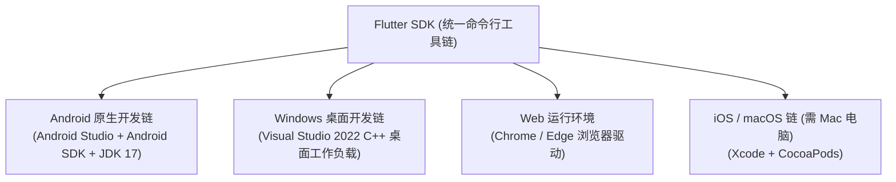

# 00 Flutter 全平台环境搭建与工程工具链入门

> **写在前面**：跨端开发环境的搭建是进入 Flutter 生态的第一道基石。因为 Flutter 不仅需要 Dart 运行时，还需要与底层原生环境（Android SDK、JDK、Windows C++ 编译工具链、iOS Xcode 等）深度打通。
>
> 本篇作为全系列的**前置起步篇**，系统梳理国内网络镜像源配置、全平台 SDK 安装、IDE 调试技巧、CLI 核心命令，并手把手带你跑通第一个跨端应用。

---

## 1. 国内网络加速镜像配置（首要必做步骤）

由于 Google 官方源在国内访问常年存在连接超时或断流问题，在下载 Flutter SDK 及后续下载 pub 依赖库之前，**必须首先配置国内镜像环境变量**。

### 1.1 Windows 环境配置方法

在 Windows “系统属性 -> 环境变量 -> 用户变量” 中添加以下两条：

| 变量名 (Variable Name) | 变量值 (Variable Value) | 镜像提供方 |
| :--- | :--- | :--- |
| `PUB_HOSTED_URL` | `https://pub.flutter-io.cn` | 官方中国反代源（上海交大/清华亦可） |
| `FLUTTER_STORAGE_BASE_URL` | `https://storage.flutter-io.cn` | 官方 Flutter 静态资源存储源 |

> [!TIP]
> **PowerShell 临时生效验证命令**：
> ```powershell
> $env:PUB_HOSTED_URL="https://pub.flutter-io.cn"
> $env:FLUTTER_STORAGE_BASE_URL="https://storage.flutter-io.cn"
> ```

---

## 2. Flutter SDK 下载与环境变量配置

### 2.1 SDK 下载与路径规范

1. 访问 [Flutter 中文网 / 官方渠道](https://docs.flutter.cn/get-started/install) 下载最新的稳定版（Stable Channel，建议 3.24.x 或以上）。
2. **解压目录规范（极其关键）**：
   - 推荐解压至：`C:\src\flutter` 或 `D:\DevTools\flutter`；
   - ❌ **绝对不要**解压至包含空格或特殊字符的目录（例如 `C:\Program Files\flutter`）；
   - ❌ **绝对不要**解压至需要系统高权限提权的目录（避免构建时触发 `EPERM` 写入权限错误）。

### 2.2 配置系统 PATH 变量

将 Flutter 的 `bin` 目录路径追加到系统的 `Path` 环境变量中：
- 例如：`D:\DevTools\flutter\bin`

打开全新的终端（PowerShell 或 CMD），运行以下命令验证：
```powershell
flutter --version
dart --version
```
若能正确输出版本号，说明 Flutter SDK 基础命令行已就绪。

---

## 3. 全平台原生构建环境装配

Flutter 真正的跨端在于其能输出不同平台的原生目标产物，因此需要对应安装目标平台的编译链。



### 3.1 Android 原生构建环境（移动端必装）

1. **下载安装 Android Studio**：前往官网下载并安装 [Android Studio](https://developer.android.google.cn/studio)。
2. **安装 Android SDK 组件**：
   - 打开 Android Studio，进入 `Settings -> Languages & Frameworks -> Android SDK`；
   - 在 **SDK Platforms** 勾选最新的 Android API（如 Android 14.0 / API 34）；
   - 在 **SDK Tools** 标签页，**务必勾选以下三项**：
     - `Android SDK Build-Tools`
     - `Android SDK Command-line Tools (latest)`（**漏勾此项会导致 flutter doctor 报错**）
     - `Android SDK Platform-Tools`
3. **同意 Android 开发者协议证书**：
   在终端运行以下命令，全程输入 `y` 确认接收所有证书许可：
   ```powershell
   flutter doctor --android-licenses
   ```
4. **配置 Android 模拟器 (AVD)**：
   - 在 Android Studio 中打开 `Virtual Device Manager`；
   - 点击 `Create Device`，选择一款主流机型（如 Pixel 7），下载推荐的系统镜像（推荐选择带 Google APIs 的 x86_64 镜像），点击完成即可一键启动模拟器。
5. **真机调试（备选）**：
   - 使用 USB 数据线连接你的 Android 手机；
   - 手机进入“设置 -> 关于手机”，连续点击“版本号” 7 次开启“开发者选项”；
   - 进入“开发者选项”，开启 **“USB 调试”**（小米手机需额外开启“USB 安装”和“USB 调试(安全设置)”）。

### 3.2 Windows 桌面端构建环境

若需在 Windows 电脑上开发并编译 Windows 桌面端应用（.exe）：
1. 下载并安装 [Visual Studio 2022 Community（社区版）](https://visualstudio.microsoft.com/zh-hans/vs/)；
2. 在安装程序中，勾选 **“使用 C++ 的桌面开发” (Desktop development with C++)** 工作负载；
3. 确保包含默认勾选项：MSVC v143、Windows 10/11 SDK、CMake 工具等。

### 3.3 终极环境诊断体检：flutter doctor

在终端中执行：
```powershell
flutter doctor -v
```

理想的输出应当全为绿色勾号：
```text
[✓] Flutter (Channel stable, 3.24.5, on Microsoft Windows ...)
[✓] Windows Version (Installed version of Windows is 10/11 ...)
[✓] Android toolchain - develop for Android devices (Android SDK version 34.0.0)
[✓] Chrome - develop for the web
[✓] Visual Studio - develop for Windows (Visual Studio Community 2022 17.x)
[✓] Android Studio (version 2024.x)
[✓] Connected device (3 available)
[✓] Network resources
```

> [!NOTE]
> 如果看到黄色 `[!]` 或红色 `[✗]`：
> - 提示 `cmdline-tools component is missing`：参考 3.1 节在 Android Studio 的 SDK Tools 中勾选 `Command-line Tools (latest)`；
> - 提示 `Android license status unknown`：运行 `flutter doctor --android-licenses` 并一路按 `y`。

---

## 4. IDE 与高效开发扩展配置

Flutter 官方支持 **VS Code** 与 **Android Studio / IntelliJ IDEA**。两者均具备完整的断点调试、组件检查器（Widget Inspector）与热重载能力。

### 4.1 VS Code 黄金插件组合

在 VS Code 插件市场搜索并安装：
1. **Flutter** (`Dart-Code.flutter`)：提供代码高亮、Widget 树大纲、设备选择器、一键调试与热重载。
2. **Dart** (`Dart-Code.dart-code`)：提供 Dart 语言智能补全、重构与分析引擎。
3. **Flutter Riverpod Snippets**：快速生成 Riverpod Provider 与 ConsumerWidget。
4. **Bloc** (`FelixAngelov.bloc`)：快速创建 BLoC、Cubit、Event 与 State 模板文件。
5. **Error Lens** (`usernamehw.errorlens`)：直接将语法错误与代码告警内联显示在代码行后，无需悬停鼠标即可快速发现类型与空安全问题。

### 4.2 高效重构快捷键与代码生成技巧

在 VS Code 中将光标置于任何 Widget 上，按下快捷键：
- **Windows**: `Ctrl + .`
- **macOS**: `Cmd + .`

会弹出极度强大的 **Flutter 辅助重构菜单**：
- **Wrap with Container / Padding / Center / Row / Column**：一键用特定容器包裹当前组件（无需手动复制粘贴闭合括号！）；
- **Remove this widget**：安全剥离当前外层 Widget，保留其子节点；
- **Convert to StatefulWidget**：一键将无状态组件转换为有状态组件，自动生成 `State` 类。

---

## 5. 核心 CLI 命令行实战与工程化

Flutter 提供了高度统一的命令行工具链，常用命令索引如下：

| 常用工程阶段 | Flutter 核心命令 | 功能作用 |
| :--- | :--- | :--- |
| **初始化工程** | `flutter create --org com.company my_app` | 规范化创建新工程，`--org` 指定包名反转域名 |
| **安装依赖** | `flutter pub get` | 下载并安装 `pubspec.yaml` 中配置的所有第三方依赖 |
| **升级依赖** | `flutter pub upgrade` | 升级依赖版本至符合语义范围的最新版 |
| **启动调试** | `flutter run` | 启动当前项目并自动附加调试器 |
| **指定目标设备** | `flutter run -d chrome` / `flutter run -d windows` | 指定运行在特定目标设备（浏览器/桌面/模拟器） |
| **清理缓存** | `flutter clean` | 清除所有编译缓存与临时生成文件（解决由于增量构建导致的异常） |
| **编译生产包** | `flutter build apk` / `flutter build web` | 编译生产打包发布产物 |

### 5.1 查看当前可用设备

```powershell
flutter devices
```
会列出当前已连接的手机、正在运行的模拟器、Chrome 以及当前操作系统的桌面端（Windows / macOS）。

### 5.2 热重载 (Hot Reload) vs 热重启 (Hot Restart)

Flutter 最具革命性的能力之一就是毫秒级调试循环：

```mermaid
flowchart LR
    Change["代码修改保存"] --> Option1["热重载 Hot Reload (按键 'r')"]
    Change --> Option2["热重启 Hot Restart (按键 'R')"]
    
    Option1 -->|仅向 Dart VM 注入新代码<br/>保留内存中的当前状态 (State)| Screen1["毫秒级 UI 刷新<br/>(表单输入内容不丢失)"]
    Option2 -->|销毁整个 Widget 树与 State<br/>重新执行 main() 初始化| Screen2["重置应用状态回到初始页"]
```

> [!WARNING]
> **热重载何时会失效？**
> 1. 修改了 `main()` 函数中的初始化逻辑；
> 2. 修改了类的全局静态变量声明（`static final`）；
> 3. 修改了 `initState()` 生命周期方法的内容；
> 4. 新增或修改了原生 Android / iOS 平台代码或第三方插件。
> 遇到上述情况，**必须在终端按大写 `R`（热重启）或重新停止并运行应用**。

---

## 6. 第一个 Flutter 入门应用：从 main() 到组件交互

创建并进入你的第一个应用：
```powershell
flutter create --org com.enterprise hello_flutter
cd hello_flutter
```

打开 `lib/main.dart`，我们将其精简为一个具备企业级标准结构、清晰展示“声明式 UI 与状态更新”的入门示例：

```dart
// lib/main.dart
import 'package:flutter/material.dart';

// 1. 程序唯一执行入口
void main() {
  // runApp 将根组件挂载到屏幕渲染树顶层
  runApp(const MyEnterpriseIntroApp());
}

// 2. 根应用组件 (通常配置全局主题、多语言与路由)
class MyEnterpriseIntroApp extends StatelessWidget {
  const MyEnterpriseIntroApp({super.key});

  @override
  Widget build(BuildContext context) {
    return MaterialApp(
      title: 'Flutter 入门教学',
      debugShowCheckedModeBanner: false, // 隐藏右上角 Debug 标签
      theme: ThemeData(
        useMaterial3: true,
        colorSchemeSeed: Colors.indigo, // 现代 Material 3 种子色板自动计算
      ),
      home: const CounterHomePage(title: 'Flutter 交互基础演示'),
    );
  }
}

// 3. 有状态组件 (StatefulWidget)
// Widget 本身依然是不可变的配置描述
class CounterHomePage extends StatefulWidget {
  final String title;

  const CounterHomePage({super.key, required this.title});

  @override
  State<CounterHomePage> createState() => _CounterHomePageState();
}

// 4. 真正持有可变状态与构建逻辑的 State 类
class _CounterHomePageState extends State<CounterHomePage> {
  // 内部业务状态 (类似于 React useState / Vue ref)
  int _counter = 0;

  void _incrementCounter() {
    // 关键核心：setState() 告知框架该组件状态已改变，
    // Flutter 框架会在下一帧调度重新执行当前 State 的 build() 方法
    setState(() {
      _counter++;
    });
  }

  void _resetCounter() {
    setState(() {
      _counter = 0;
    });
  }

  @override
  Widget build(BuildContext context) {
    // Scaffold 是 Material 风格的基础页面骨架 (包含 appBar, body, floatingActionButton 等插槽)
    return Scaffold(
      appBar: AppBar(
        title: Text(widget.title),
        backgroundColor: Theme.of(context).colorScheme.inversePrimary,
        actions: [
          IconButton(
            icon: const Icon(Icons.refresh),
            tooltip: '重置计数器',
            onPressed: _resetCounter,
          ),
        ],
      ),
      body: Center(
        child: Column(
          mainAxisAlignment: MainAxisAlignment.center,
          children: <Widget>[
            const Text(
              '当前累计点击次数：',
              style: TextStyle(fontSize: 16, color: Colors.grey),
            ),
            const SizedBox(height: 12),
            // 响应式展示当前状态值
            Text(
              '$_counter',
              style: Theme.of(context).textTheme.displayMedium?.copyWith(
                    fontWeight: FontWeight.bold,
                    color: Theme.of(context).colorScheme.primary,
                  ),
            ),
          ],
        ),
      ),
      // 底部浮动交互按钮
      floatingActionButton: FloatingActionButton.extended(
        onPressed: _incrementCounter,
        icon: const Icon(Icons.add),
        label: const Text('增加数值'),
      ),
    );
  }
}
```

### 运行并观察：
```powershell
# 运行在浏览器中快速预览
flutter run -d chrome

# 或运行在已启动的 Android 模拟器中
flutter run
```

---

## 7. 常见环境问题速查与排坑手册

### Q1: `flutter pub get` 一直停在 `Resolving dependencies...` 卡死不动？
- **原因**：网络无法连接到官方 `pub.dev` 服务器。
- **解法**：检查第 1 节中的 `PUB_HOSTED_URL` 与 `FLUTTER_STORAGE_BASE_URL` 环境变量是否已全局正确设置，重启终端后重试。

### Q2: 报错 `Android SDK not found at this location`？
- **解法**：通过 Flutter 显式指定 Android SDK 物理安装目录：
  ```powershell
  flutter config --android-sdk "C:\Users\<你的用户名>\AppData\Local\Android\Sdk"
  ```

### Q3: 运行 Android 编译时卡在 `Running Gradle task 'assembleDebug' ...` 超过 10 分钟？
- **原因**：Gradle 正在下载海外的 Gradle Wrapper 压缩包或 Google Maven 仓库依赖。
- **解法**：修改项目目录下的 `android/build.gradle`（或新版 `settings.gradle`），将 maven 仓库替换为阿里云镜像：
  ```groovy
  maven { url 'https://maven.aliyun.com/repository/google' }
  maven { url 'https://maven.aliyun.com/repository/public' }
  ```

---

## 8. 下一步学习路线

当你的运行环境通过 `flutter doctor -v` 并成功在屏幕上点亮第一个计数器应用后，说明全套工具链已经彻底通畅。

接下来，请按照以下规划深入攻坚：
1. 前往 **[`01_Dart3现代编程语言从零到精通.md`](./01_Dart3现代编程语言从零到精通.md)** 深入掌握 Dart 3 强类型、命名参数、空安全与 Isolate 并发；
2. 随后进入 **[`02_Flutter内核渲染机制与布局体系精讲.md`](./02_Flutter内核渲染机制与布局体系精讲.md)** 攻克约束模型与三棵树内核；
3. 一路挺进企业级 Clean Architecture、双状态管理与工程化实战！

---

## 9. 官方权威参考资料 (docs.flutter.cn)

- [Flutter 官方安装指南 (Windows / macOS / Linux)](https://docs.flutter.cn/get-started/install)
- [中国国内网络镜像配置官方指南](https://docs.flutter.cn/community/china)
- [Android 物理设备与模拟器配置手册](https://docs.flutter.cn/get-started/install/windows/mobile#set-up-the-android-device)
- [VS Code 与 Flutter 扩展深度集成](https://docs.flutter.cn/tools/vs-code)
- [热重载 (Hot Reload) 物理运行机制与限制](https://docs.flutter.cn/tools/hot-reload)

