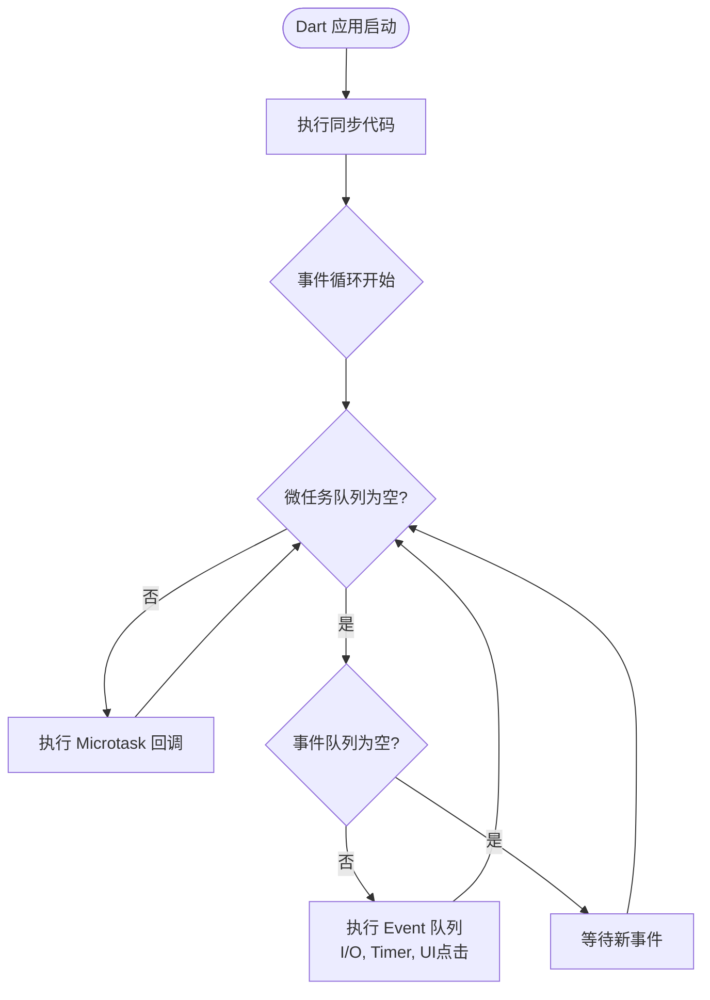

# 01 Dart 3 现代编程语言从零到精通

Dart 是 Flutter 的核心驱动引擎与编程语言底座。Dart 3 是一门具备现代工业级特性的通用面向对象语言，具备**健全静态强类型（Sound Type System）**、**物理级空安全保障（Sound Null Safety）**、**声明式模式匹配（Patterns & Records）**以及**内存隔离的并发模型（Isolate）**。

本篇将从计算机语言的第一性原理出发，系统性解析 Dart 3 的全套现代语法体系与运行机制，彻底打牢跨端架构开发的语言基础。

---

## 1. 变量声明与类型系统

### 1.1 变量声明关键字对比

在 TypeScript 中，使用 `let`、`const` 以及 `as const` 来控制变量的可变性与引用不可变。Dart 提供了更为严谨的编译期保证：

```dart
// 1. var: 类型推断。一旦确定类型，无法再赋予其他类型（不同于 JS 的 var）
var userName = 'Antigravity'; // 推断为 String
// userName = 123; // 编译报错：A value of type 'int' can't be assigned to a variable of type 'String'

// 2. final: 单次赋值变量。运行时确定值后不可再被赋予新引用
final DateTime requestTime = DateTime.now(); // 正确：运行时动态计算

// 3. const: 编译期常量。必须在编译期即可完全确定值，并在物理内存中享有单一实例（Canonicalized）
const double maxScreenWidth = 1080.0;
const List<int> defaultPortRange = [8000, 8080]; // 列表内容同样不可变

// 4. late: 延迟初始化。用于必须非空但无法在声明时立即赋值的成员变量
late final String authToken;
void setup() {
  authToken = 'Bearer eyJhbGciOi...';
}
```

> [!IMPORTANT]
> **常量不可变性剖析**：
> - 许多动态语言中的“常量”仅指“引用不可变”（例如所指对象的属性依然可被篡改）。
> - Dart 的 `const` 是**深度不可变（Deep Immutability）**：所修饰的对象及其内部嵌套结构在编译期即被固化并放入只读内存区，多处引用相同的常量会复用全局唯一内存实例（Canonicalization）。
> - 在 Flutter 中，组件使用 `const MyWidget()` 构造时，渲染管线可直接跳过比对复用已有内存节点，极大幅度提升构建效率。

### 1.2 核心内置类型

```dart
// 标量类型
int count = 10;
double price = 99.9;
num generalNumber = 100; // int 和 double 的基类
bool isActive = true;
String title = "Flutter Enterprise";

// 字符串插值 (对标 JS 模板字符串 `${val}`)
String message = 'Item count: $count, Total: \${price * count}';

// 集合类型
List<String> tags = ['Mobile', 'Web', 'Desktop'];
Set<String> uniqueCodes = {'A001', 'A002', 'A001'}; // 自动去重，长度为 2
Map<String, dynamic> userPayload = {
  'id': 1001,
  'role': 'admin',
  'permissions': ['read', 'write']
};
```

---

## 2. 函数与核心调用机制

Flutter 声明式 UI 本质上就是由多层嵌套的构造函数与回调函数组成。深入掌握 Dart 的参数机制是写出整洁 UI 代码的关键。

### 2.1 位置参数 vs 命名参数

在 TypeScript 中，通常通过解构配置对象实现命名参数：`function fetchUser({ id, detail }: { id: string; detail?: boolean })`。Dart 将此机制提升到了语言的一等公民地位：

```dart
// 1. 位置参数 (Positional Parameters)
String formatName(String first, String last) {
  return '$first $last';
}

// 2. 命名参数 (Named Parameters，使用花括号包裹)
// required 标注必填；若无 required 则必须声明为可空类型或提供默认值
void configureServer({
  required String host,
  int port = 8080,
  String? certPath, // 可选可空
}) {
  print('Server starting at $host:$port (Cert: $certPath)');
}

// 调用处：命名参数无需保证顺序，可读性极强
void main() {
  configureServer(
    host: 'api.enterprise.com',
    port: 443,
  );
}
```

### 2.2 函数作为一等公民与 typedef

```dart
// 定义高阶函数类型别名（对标 TS 的 type Callback = (value: int) => void）
typedef ValueTransformer<T> = T Function(T input);
typedef VoidCallback = void Function();

T processData<T>(T source, ValueTransformer<T> transformer) {
  return transformer(source);
}

void testHigherOrder() {
  // 匿名函数与箭头语法
  final result = processData<int>(10, (val) => val * 2);
  print(result); // 20
}
```

---

## 3. 面向对象与构造函数（Flutter 架构底座）

Dart 采用纯面向对象模型，所有值（包括数字和布尔值）皆为对象（继承自 `Object?`）。

### 3.1 构造函数语法全解

Flutter 的 Widget 树充斥着构造函数的特定写法：

```dart
class UserModel {
  final String id;
  final String name;
  final int age;
  final DateTime createdAt;

  // 1. 语法糖构造函数：this.field 自动赋值给成员变量
  // 2. 初始化列表 (Initializer List)：在构造函数体运行之前执行
  UserModel({
    required this.id,
    required this.name,
    this.age = 18,
  }) : createdAt = DateTime.now() {
    // 构造函数体（通常可选）
    assert(id.isNotEmpty, 'id must not be empty');
  }

  // 3. 命名构造函数 (Named Constructor)：解决 TS/JS 中只能有一个 constructor 的痛点
  UserModel.guest()
      : id = 'guest_000',
        name = 'Anonymous',
        age = 0,
        createdAt = DateTime.now();

  // 4. 工厂构造函数 (Factory Constructor)：用于单例、缓存实例化或返回子类
  factory UserModel.fromJson(Map<String, dynamic> json) {
    return UserModel(
      id: json['id'] as String,
      name: json['name'] as String,
      age: json['age'] as int? ?? 18,
    );
  }

  // 5. 常量构造函数 (Const Constructor)：要求所有字段必须为 final
  // 一旦调用 const UserModel.immutable(...)，在编译期常量池共享
}
```

### 3.2 级联操作符与空感知级联

对标链式调用，Dart 提供了强大的级联操作符 `..` 与 `?..`：

```dart
class PaintConfig {
  String color = 'blue';
  double strokeWidth = 1.0;
  void reset() {
    color = 'black';
    strokeWidth = 1.0;
  }
}

void setupPaint() {
  // 使用级联在同一个对象上连续执行多次赋值或方法调用，返回该对象本身
  final paint = PaintConfig()
    ..color = 'red'
    ..strokeWidth = 2.5
    ..reset();

  PaintConfig? optionalPaint;
  // 空感知级联：仅当 optionalPaint 不为 null 时执行
  optionalPaint
    ?..color = 'green'
    ..strokeWidth = 3.0;
}
```

---

## 4. 继承、接口与 Mixin 混入机制

### 4.1 隐式接口（Implicit Interface）与 extends/implements

在 TypeScript 中，`interface` 与 `class` 是独立概念。而在 Dart 中：**每一个类都隐式定义了一个包含其所有实例成员的接口**。

```dart
abstract class Repository {
  Future<String> fetchData();
}

// 继承：获取父类实现并可重写
class RemoteRepository extends Repository {
  @override
  Future<String> fetchData() async => "Remote Data";
}

// 实现：必须全量实现该类所声明的所有方法和字段（即使被实现的类是具体类）
class MockRepository implements Repository {
  @override
  Future<String> fetchData() async => "Mock Data";
}
```

### 4.2 Mixin 混入（严谨的细粒度行为组合机制）

传统的单继承无法跨体系复用行为，而多继承又极易引发恶名昭彰的“菱形继承冲突（Diamond Problem）”。Dart 引入了严格线型化的 `mixin` 机制：

```dart
// 定义 mixin
mixin LoggerMixin {
  void log(String message) {
    print('[${DateTime.now().toIso8601String()}] $message');
  }
}

// 通过 on 约束该 mixin 只能被特定类型的子类混入
mixin DisposableLifecycle on Repository {
  void dispose() {
    print('Disposing resources...');
  }
}

// 使用 with 混入能力
class ProductionService extends Repository with LoggerMixin, DisposableLifecycle {
  @override
  Future<String> fetchData() async {
    log('Fetching production data...');
    return 'Prod Data';
  }
}
```

---

## 5. 健全空安全（Sound Null Safety）

### 5.1 编译期分析 vs 健全空安全物理保障

> [!WARNING]
> **底层区别警告**：
> - 部分语言（如带有静态分析插件的动态语言）的空检查仅停留在编译期的语法扫描阶段，编译生成的底层二进制或字节码中并没有真正的类型防御，一旦遇到越界或反序列化缺漏，依然会在运行时崩溃。
> - **Dart 健全空安全（Sound Null Safety）**：是**运行时 + 编译期全链路强保证**。如果一个变量声明为非空类型（如 `String`），Dart 虚拟机和 AOT 编译器在物理层面上保证其绝对不可能是 `null`。编译器能基于此消除防御性的冗余指令，进行激进的内存布局内联优化。

### 5.2 空安全核心语法与操作符

```dart
// 1. 可空类型与非空类型
String nonNullable = "Must have value";
// nonNullable = null; // 编译报错

String? nullable = null; // 正确：可空

// 2. 空条件访问 (?.) 与 空值合并 (??)
int? length = nullable?.length; // length 类型为 int?
int safeLength = nullable?.length ?? 0; // safeLength 类型为 int

// 3. 空赋值操作符 (??=)
String? token;
token ??= 'DefaultToken'; // 若 token 为空则赋值，否则保留原值

// 4. 空断言操作符 (!) - 强制解除可空，若为 null 抛出 TypeError（慎用，仅在绝对确定时使用）
String mustBeString = nullable!; 

// 5. 智能类型提升 (Type Promotion)
void printLength(String? text) {
  if (text != null) {
    // 离开 if 后，编译器自动将 text 提升为非空 String，无需手动断言
    print(text.length);
  }
}
```

---

## 6. Dart 3 核心现代特性（Records 与 Patterns）

Dart 3 引入了现代函数式语言中极其强大的**元组（Records）**与**模式匹配（Patterns）**，彻底革新了解析数据与构建状态机的效率。

### 6.1 Records（轻量级强类型元组）

以往当一个方法需要返回多个异构字段时，必须额外声明一个专用的数据类或通过弱类型集合传递。Dart 3 提供了原生、紧凑且强类型的 Records（元组）：

```dart
// 返回包含位置字段与命名字段的元组
(int statusCode, {String message, Map<String, dynamic>? payload}) requestApi() {
  return (200, message: 'OK', payload: {'user_id': 99});
}

void testRecord() {
  final response = requestApi();
  print(response.$1); // 位置字段使用 $1, $2 访问 -> 200
  print(response.message); // 命名字段直接访问 -> 'OK'
}
```

### 6.2 模式解构与 Switch 表达式

```dart
// 1. 解构赋值 (Destructuring)
final (code, message: msg, payload: data) = requestApi();
print('Status: $code, Msg: $msg');

// 2. Switch 表达式（用于简洁表达状态机与多路分支）
String getHttpStatusDescription(int statusCode) => switch (statusCode) {
  200 => 'Success',
  >= 400 && < 500 => 'Client Error',
  >= 500 && < 600 => 'Server Error',
  _ => 'Unknown Status', // 通配符 _
};

// 3. 复杂结构模式解构
void parseJson(Map<String, dynamic> json) {
  switch (json) {
    case {'type': 'user', 'profile': {'name': String name, 'age': int age}}:
      print('User: $name, Age: $age');
    case {'type': 'system_event', 'code': int errCode}:
      print('System event: $errCode');
    default:
      print('Unsupported schema');
  }
}
```

### 6.3 密封类（`sealed` class）与穷举检查

在大型软件中，状态机往往要求绝对的确定性。Dart 3 通过 `sealed` 关键字实现代数数据类型（Algebraic Data Types），编译器会强制要求在模式匹配时穷举所有可能子类：

```dart
// sealed 类具有包内隐式封闭性，不可在当前库外部继承
sealed class UiState {}

class InitialState extends UiState {}
class LoadingState extends UiState {}
class SuccessState extends UiState {
  final List<String> data;
  SuccessState(this.data);
}
class ErrorState extends UiState {
  final String error;
  ErrorState(this.error);
}

// 编译器自动进行 Exhaustiveness Checking（穷举检查）
// 若遗漏任何一个子类，编译直接报错！
Widget renderView(UiState state) {
  return switch (state) {
    InitialState() => const Text('Ready'),
    LoadingState() => const CircularProgressIndicator(),
    SuccessState(data: var items) => ListView(children: items.map(Text.new).toList()),
    ErrorState(error: var msg) => Text('Error: $msg', style: const TextStyle(color: Colors.red)),
  };
}
```

### 6.4 扩展方法与 Dart 3.3+ 扩展类型（Extension Types 零成本抽象）

根据 [Dart 官方文档 (dart.cn/language/extension-types)](https://dart.cn/language/extension-types)，Dart 提供了两套能力强大的扩展机制：

#### 1. 扩展方法 (Extension Methods)
允许为现有类（甚至是 SDK 内置类或第三方库类）无侵入地挂载新方法：

```dart
// 为已有 String 类扩展实用业务方法
extension StringCryptoX on String {
  bool get isValidEmail => RegExp(r'^[\w-\.]+@([\w-]+\.)+[\w-]{2,4}$').hasMatch(this);

  String maskSensitive() {
    if (length <= 4) return this;
    return replaceRange(2, length - 2, '****');
  }
}

void testExtension() {
  print('user@enterprise.com'.isValidEmail); // true
  print('13812345678'.maskSensitive());      // 13****78
}
```

#### 2. 扩展类型 (Extension Types - Dart 3.3 核心杀手级特性)
传统的封装往往需要创建一个新的 `class Wrapper { final Target value; }`，这会在堆内存中产生真实的额外对象分配与垃圾回收开销。
Dart 3.3+ 引入的 **Extension Types** 是**纯编译期的类型安全包装器（Zero-cost Abstraction）**，编译后完全被底层类型替换，享有**零运行时物理内存分配代价**：

```dart
// 1. 强类型 ID 包装器：底层仅是一个普通的 int，但编译期彻底杜绝不同 ID 混用的低级错误！
extension type const UserId(int id) {
  // 可以声明仅属于该扩展类型的操作与方法
  bool get isSystemAdmin => id == 0;
}

extension type const OrderId(int id) {}

void processOrder(UserId user, OrderId order) {
  print('User: ${user.id}, Order: ${order.id}');
}

void testExtensionType() {
  const uid = UserId(1001);
  const oid = OrderId(9999);

  processOrder(uid, oid); // 正确
  // processOrder(oid, uid); // 编译直接报错！即使两者底层都是 int，类型系统实现了强隔离
}

// 2. 类型安全的 JSON 强类型视图 (无须反序列化整个 Map)
extension type JsonUserView(Map<String, dynamic> data) {
  String get name => data['name'] as String;
  int get age => data['age'] as int? ?? 0;
}
```

---

## 7. 异步体系与 Isolate 多线程并发

### 7.1 事件循环与微任务队列

Dart 采用基于事件循环的单线程并发模型：



```dart
void testEventLoop() {
  print('1: Sync');

  // 事件队列 (Event Queue)
  Future(() => print('4: Future Event'));

  // 微任务队列 (Microtask Queue)
  scheduleMicrotask(() => print('2: Microtask'));

  print('3: Sync End');
}
// 输出顺序: 1 -> 3 -> 2 -> 4
```

### 7.2 Stream 响应式流处理

对于实时连续的数据流（如 WebSocket 消息、传感器连续数据流、按键流），Dart 原生内置了 `Stream`：

```dart
import 'dart:async';

// 使用 async* 与 yield 生成数据流
Stream<int> counterStream({int max = 5}) async* {
  for (int i = 1; i <= max; i++) {
    await Future.delayed(const Duration(milliseconds: 200));
    yield i; // 持续发射流事件
  }
}

// 订阅与操作符流转
void listenStream() async {
  final stream = counterStream()
      .where((val) => val.isEven) // 过滤偶数
      .map((val) => 'Count: $val'); // 变换

  await for (final message in stream) {
    print(message); // 输出 Count: 2, Count: 4
  }
}
```

### 7.3 Isolate：真正的物理级多线程并发

> [!CAUTION]
> **多线程与渲染帧率的关系**：
> Flutter 的 UI 渲染运行在 `Main Isolate` 上。如果主线程执行长达 50ms 的密集计算（如大文件计算 MD5 或解析 10MB 的 JSON 列表），界面会出现**剧烈掉帧卡顿（Jank）**。
> `Isolate` 拥有**完全独立的堆内存与独立的垃圾回收（GC）空间**，互不争抢锁，通过 Port 端口进行通信。

#### 生产级 Isolate 高性能计算实战：

```dart
import 'dart:isolate';
import 'dart:convert';

// 密集计算任务必须是顶级函数 (Top-level) 或静态方法 (Static)
List<Map<String, dynamic>> _parseLargeJsonTask(String rawJson) {
  final parsed = jsonDecode(rawJson) as List<dynamic>;
  return parsed.map((e) => e as Map<String, dynamic>).toList();
}

class HeavyWorkerService {
  // 简易快捷并发：使用 Isolate.run() (Dart 2.19+ 推荐标准)
  Future<List<Map<String, dynamic>>> parseJsonConcurrently(String jsonString) async {
    // 自动在后台 Isolate 运行，并在计算完毕后关闭该 Isolate 返回结果
    return await Isolate.run(() => _parseLargeJsonTask(jsonString));
  }

  // 长生命周期双向通信 Isolate (用于实时大数据包流式解析)
  Future<void> startPersistentWorker() async {
    final receivePort = ReceivePort();

    // 派生子 Isolate
    await Isolate.spawn(_backgroundWorkerEntryPoint, receivePort.sendPort);

    // 监听子 Isolate 发回的握手通信 Port
    final completer = Completer<SendPort>();
    receivePort.listen((message) {
      if (message is SendPort) {
        completer.complete(message);
      } else {
        print('Received computation result from worker: $message');
      }
    });

    final workerSendPort = await completer.future;
    // 向子 Isolate 发送计算指令
    workerSendPort.send({'cmd': 'compress', 'data': [1, 2, 3, 4, 5]});
  }

  static void _backgroundWorkerEntryPoint(SendPort mainSendPort) {
    final workerReceivePort = ReceivePort();
    // 首次握手：将自身的 SendPort 回传给主 Isolate
    mainSendPort.send(workerReceivePort.sendPort);

    workerReceivePort.listen((task) {
      if (task is Map) {
        // 执行重度计算
        final result = 'Processed ${task['cmd']}';
        // 发送结果回主线程
        mainSendPort.send(result);
      }
    });
  }
}
```

---

## 8. 语言设计总结与工程规范清单

- **常量控制**：使用 `const` 修饰 Widget 构造函数与静态集合，换取卓越的运行时性能与内存实例复用。
- **参数书写**：习惯使用带 `{required this.xxx}` 的命名参数编写组件。
- **类型保证**：充分信任 Dart 健全空安全，避免写出无意义的防御性冗余代码，善用智能类型提升。
- **状态表达**：优先使用 `sealed class` + `switch expression` 构建严密的业务状态机。
- **零成本封装**：在需要类型安全保护的底层类型（如 ID 标识、未解析 JSON）上，优先采用 Dart 3.3+ 的 `extension type`。
- **性能红线**：一旦遇到高负荷计算，立刻使用 `Isolate.run()` 将其移离主线程。

---

## 9. 官方权威参考资料 (Dart.cn)

- [Dart 语言概览 (Language Tour)](https://dart.cn/language)
- [模式匹配与解构 (Patterns)](https://dart.cn/language/patterns)
- [类修饰符与密封类 (Class Modifiers)](https://dart.cn/language/class-modifiers)
- [扩展类型核心规范 (Extension Types)](https://dart.cn/language/extension-types)
- [Dart 并发与 Isolate 架构 (Concurrency)](https://dart.cn/language/concurrency)

