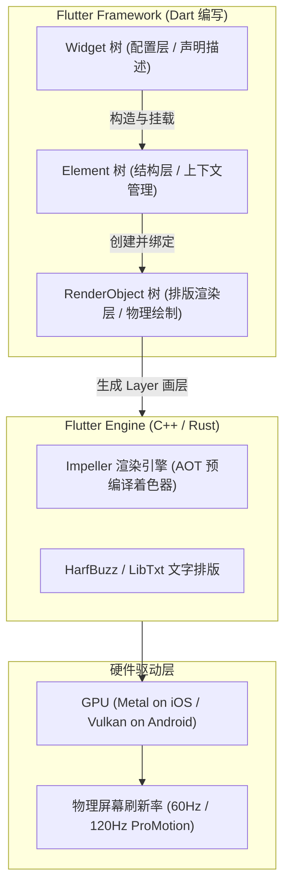
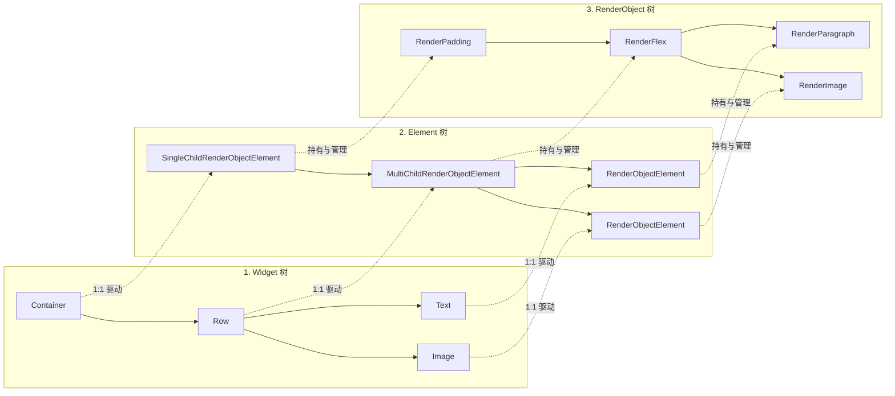
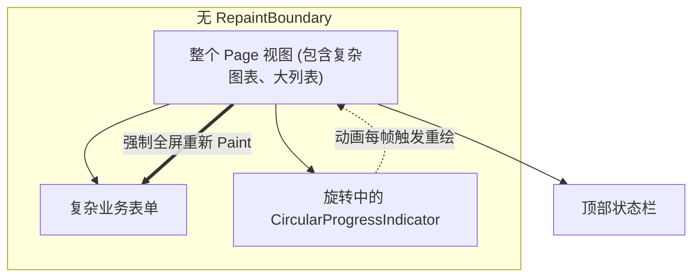
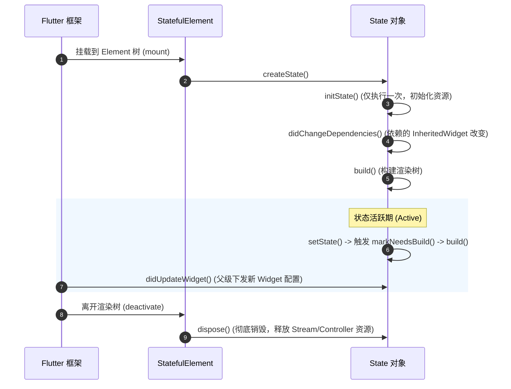

# 02 Flutter 内核渲染机制与布局体系精讲

在声明式 UI 框架中，理解视图背后的排版算法与绘制管线是写出高性能界面的前提。在 Flutter 中，初学者最常遇到的异常莫过于 `RenderFlex overflowed`（布局溢出）或 `Vertical viewport was given unbounded height`（视口无界高度死锁）。

本篇将从底层图形渲染引擎出发，彻底揭秘 Flutter 的**三棵树机制**、**约束传递物理法则**、**重绘边界隔离**以及 **Key 与组件生命周期**，从系统底层掌握 Flutter 达到 60fps/120fps 丝滑流畅的架构奥秘。

---

## 1. 渲染引擎与三棵树核心架构

### 1.1 摒弃 DOM 与 Impeller 新一代图形引擎革命

现代浏览器需要经历 `HTML Parser -> DOM 树 -> CSSOM 树 -> Render Tree -> Layout (排版) -> Paint (绘制) -> Composite (合成)` 的庞大流程，跨层级开销巨大。

Flutter 从根本上摒弃了浏览器架构，直接通过 C++ 编写的底层引擎调用图形 API。在 Flutter 3.x 中，官方全面推出了新一代自研渲染引擎 **Impeller**（彻底替代历史遗留的 Skia）：

> [!NOTE]
> **官方权威对比 (docs.flutter.cn/perf/impeller)**：
> - **旧时代 Skia 的痛点**：在运行时首次遇到某种视觉样式或渐变时，才在主线程 JIT 编译图形着色器（Shader），从而引发不可预测的**着色器编译卡顿（Shader Compilation Jank）**。
> - **Impeller 核心革命**：**全量预编译着色器（Ahead-of-Time Shaders）**。所有需要的着色器在构建应用时全部编译完成，在运行时直接下发 GPU 硬件（iOS/macOS 使用 Metal，Android 使用 Vulkan），彻底消灭了首发卡顿，真正实现 120Hz ProMotion 级稳定帧率输出。



### 1.2 三棵树的分工与 Diff 算法



| 树类型 | 职责定位 | 内存代价 | 生命周期特征 |
| :--- | :--- | :--- | :--- |
| **Widget 树** | **不可变的 UI 蓝图与配置清单** | 极轻量 | 频繁创建与销毁。每一帧状态改变，相关的 Widget 就会全部重新 `build()` 实例化。 |
| **Element 树** | **虚拟 DOM / 上下文控制器** | 中等 | 持久保存在内存中。持有状态（StatefulElement），负责比对 Widget 差异，决定是否更新已有的 RenderObject。 |
| **RenderObject 树** | **计算布局几何尺寸、执行物理绘制** | 极重 | 拥有真实绝对坐标与像素尺寸（Size）。尽可能复用，仅当尺寸或排版属性改变时才执行 `markNeedsLayout()` 或 `markNeedsPaint()`。 |

#### Element 树的比对复用机制：

当状态发生改变调用 `setState()` 时，Element 树会检查新 Widget 与旧 Widget：

```dart
// 框架核心比对函数: Widget.canUpdate
static bool canUpdate(Widget oldWidget, Widget newWidget) {
  // 必须保证 runtimeType 相同，且 Key 完全相同，Element 才能被复用！
  return oldWidget.runtimeType == newWidget.runtimeType &&
      oldWidget.key == newWidget.key;
}
```
- 若 `canUpdate` 为 `true`：Element 节点直接保留，调用 `update(newWidget)`，将新属性更新给底层的 RenderObject。
- 若 `canUpdate` 为 `false`：Element 将旧的子节点整个卸载（unmount），销毁 RenderObject，并重新从头挂载新的 Element。

---

## 2. 布局物理法则：约束传递模型

> [!IMPORTANT]
> **Flutter 布局唯一圣经**：
> **Constraints go down. Sizes go up. Parent sets position.**
> **（约束向下传递，尺寸向内反馈，父节点决定位置。）**

### 2.1 约束的三种形态

父节点传递给子节点的是一个 `BoxConstraints` 结构体：
- `minWidth`, `maxWidth`
- `minHeight`, `maxHeight`

```dart
// 1. 紧约束 (Tight Constraints): min == max
// 子组件无法自行决定大小，必须完全填满这个固定尺寸
final tight = BoxConstraints.tight(const Size(300, 200));

// 2. 松约束 (Loose Constraints): min 为 0，max > 0
// 子组件可以在 0 到 max 之间任意选择自身尺寸
final loose = BoxConstraints.loose(const Size(300, 200));

// 3. 无边界约束 (Unbounded Constraints): max 为 double.infinity
// 子组件可以无限扩展。常见于 ListView、SingleChildScrollView 以及未被 Expanded 包裹的 Row/Column
const unbounded = BoxConstraints(minHeight: 0, maxHeight: double.infinity);
```

### 2.2 常见布局溢出与无界异常剖析

#### 崩溃一：`RenderFlex overflowed by xxx pixels`（布局溢出）

- **异常本质**：`Row` / `Column` 给子组件的约束在主轴方向是**无边界**的（`max: double.infinity`）。如果一个组件（如超长文本或多组件组合）在主轴方向请求的实际物理尺寸超过了父容器分配的物理屏幕宽度，`RenderFlex` 不会自动压缩子项，而是直接抛出越界异常并绘制黄色警示带。
- **正规解法**：使用 `Expanded` 或 `Flexible` 将无界约束转化为有界紧约束：

```dart
// 错误示范：内容过长直接导致 RenderFlex overflowed
Row(
  children: [
    const Icon(Icons.person),
    Text(veryLongUserNameString), // 崩溃！
  ],
);

// 正确示范：使用 Expanded 告知 Row 剩余空间的边界
Row(
  children: [
    const Icon(Icons.person),
    Expanded(
      child: Text(
        veryLongUserNameString,
        overflow: TextOverflow.ellipsis,
      ),
    ),
  ],
);
```

#### 崩溃二：`Vertical viewport was given unbounded height`

- **原因**：在一个垂直滚动的 `Column` 里直接放置 `ListView`。
  `Column` 对高度没有任何约束（`maxHeight: infinity`）；而 `ListView` 默认希望沿滚动方向占满所有可用空间。无限大叠加无限大，引发物理排版死锁。
- **正规解法**：
  1. 使用 `Expanded` 包裹 `ListView`，让 ListView 瓜分 Column 的剩余固定高度；
  2. 若列表长度固定，设置 `ListView(shrinkWrap: true, physics: const NeverScrollableScrollPhysics())`。

---

## 3. 常见布局组件与 CSS 对照表

| CSS 布局概念 | Flutter 对应 Widget | 核心属性与用法要点 |
| :--- | :--- | :--- |
| `<div>` 盒模型 | `Container` / `ColoredBox` / `Padding` | 优先使用 `ColoredBox` 和 `Padding`，性能比全功能 `Container` 更高。 |
| `display: flex; flex-direction: row;` | `Row` | `mainAxisAlignment` (justify-content), `crossAxisAlignment` (align-items) |
| `display: flex; flex-direction: column;` | `Column` | 垂直主轴弹性排列 |
| `flex: 1;` | `Expanded(child: ...)` | 强迫子项填满剩余空间（`FlexFit.tight`） |
| `flex: 0 1 auto;` | `Flexible(child: ...)` | 允许子项在剩余空间内自适应（`FlexFit.loose`） |
| `flex-wrap: wrap;` | `Wrap` | `spacing` (列间距), `runSpacing` (行间距) |
| `position: relative / absolute` | `Stack` + `Positioned` | 父级 `Stack` 作为画板，子级 `Positioned(top, left, ...)` 绝对定位 |
| `overflow: hidden; border-radius: 8px;` | `ClipRRect(borderRadius: ...)` | 裁剪子树物理像素 |
| `calc()` 响应式测量 | `LayoutBuilder` | 获取父级实时下发的精确 `BoxConstraints` |

---

## 4. 重绘边界（RepaintBoundary）与性能治理

在企业级应用中，高频动画（如骨架屏、下拉加载指示器、光标闪烁、跑马灯）经常导致**整个页面持续重绘**，使 CPU/GPU 占用飙升并造成掉帧。

### 4.1 绘制渲染管道与 Layer 机制

当一个 RenderObject 改变颜色或触发动画时，若没有重绘边界，它会沿着父链向上回溯调用 `markNeedsPaint()`，导致整棵子树全部重新绘制！



### 4.2 生产级边界隔离方案

使用 `RepaintBoundary` 会在底层 RenderObject 树上建立一个独立的图层（`OffsetLayer`）。引擎将子树缓存在单独的离屏显存中，动画更新时仅重绘局部图层，直接与主画面合成：

```dart
class OptimizedDashboardCard extends StatelessWidget {
  const OptimizedDashboardCard({super.key});

  @override
  Widget build(BuildContext context) {
    return Row(
      children: [
        // 静态复杂视图：由于包裹了 RepaintBoundary，不会被右侧动画干扰重绘
        const RepaintBoundary(
          child: ComplexVectorChartWidget(),
        ),
        const SizedBox(width: 16),
        // 动态加载器：隔离在独立 Layer 中
        const RepaintBoundary(
          child: CircularProgressIndicator(),
        ),
      ],
    );
  }
}
```

> [!TIP]
> **DevTools 验证方法**：
> 在 Flutter DevTools 中开启 **"Highlight Repaints"（重绘彩虹线）**。如果页面未进行任何操作，却不断闪烁彩虹色边框，说明存在未隔离的高频重绘组件，必须立即加装 `RepaintBoundary`。

---

## 5. Key 机制与复用陷阱

在现代声明式 GUI 框架中，循环渲染列表时通常需要指定唯一标识以辅助虚拟 DOM 或视图树的 Diff 比对。在 Flutter 中，Key 承担了 Element 与 Widget 的身份绑定，其机制更加底层且直接控制着组件的状态复用。

### 5.1 什么时候必须使用 Key？

**核心法则**：当同级同类别的 Widget 发生**重新排序、插入、删除**，且该 Widget 包含**自身内部独立状态（StatefulWidget）**时，必须显式指定 Key！

```dart
// 错误案例：未指定 Key 的可交换列表项
class TodoListPage extends StatefulWidget {
  const TodoListPage({super.key});

  @override
  State<TodoListPage> createState() => _TodoListPageState();
}

class _TodoListPageState extends State<TodoListPage> {
  final List<String> _todos = ['Task A', 'Task B'];

  void _swap() {
    setState(() {
      final temp = _todos[0];
      _todos[0] = _todos[1];
      _todos[1] = temp;
    });
  }

  @override
  Widget build(BuildContext context) {
    return Column(
      children: [
        ElevatedButton(onPressed: _swap, child: const Text('Swap')),
        // 错误：没有 Key！点击 Swap 后，文本更新了，但每个条目内部勾选框状态由于 Element 复用出现错位！
        ..._todos.map((todo) => TodoItemWidget(title: todo)),
        
        // 正确解法：使用 ValueKey 绑定业务唯一主键
        // ..._todos.map((todo) => TodoItemWidget(key: ValueKey(todo), title: todo)),
      ],
    );
  }
}

class TodoItemWidget extends StatefulWidget {
  final String title;
  const TodoItemWidget({super.key, required this.title});

  @override
  State<TodoItemWidget> createState() => _TodoItemWidgetState();
}

class _TodoItemWidgetState extends State<TodoItemWidget> {
  bool _checked = false;

  @override
  Widget build(BuildContext context) {
    return CheckboxListTile(
      value: _checked,
      onChanged: (val) => setState(() => _checked = val ?? false),
      title: Text(widget.title),
    );
  }
}
```

### 5.2 常用 Key 的类型选择

- **`ValueKey<T>`**：基于值的相等性（如 `ValueKey(user.id)`），列表项最常用。
- **`ObjectKey`**：基于对象的引用地址一致性。
- **`UniqueKey`**：每次构造均生成全局唯一标识，用于强制重新挂载 Element（例如重置动画状态或强制刷新富文本）。
- **`GlobalKey<T>`**：跨层级维护 Element。允许跨 Widget 树调用目标组件的 `State` 方法（如 `formKey.currentState?.validate()`），或获取其物理屏幕坐标尺寸（`RenderBox.localToGlobal`）。**开销极大，切勿在普通列表中滥用**。

---

## 6. StatefulWidget 完整生命周期



### 生命周期严谨编写规范：

```dart
class EnterpriseSearchField extends StatefulWidget {
  final String initialQuery;
  final ValueChanged<String> onSearch;

  const EnterpriseSearchField({
    super.key,
    required this.initialQuery,
    required this.onSearch,
  });

  @override
  State<EnterpriseSearchField> createState() => _EnterpriseSearchFieldState();
}

class _EnterpriseSearchFieldState extends State<EnterpriseSearchField> {
  late final TextEditingController _controller;
  late final FocusNode _focusNode;

  @override
  void initState() {
    super.initState();
    // 1. 初始化 Controller 与监听器
    _controller = TextEditingController(text: widget.initialQuery);
    _focusNode = FocusNode();
  }

  @override
  void didUpdateWidget(covariant EnterpriseSearchField oldWidget) {
    super.didUpdateWidget(oldWidget);
    // 2. 当父级传入的 initialQuery 动态改变时，按需同步本地状态
    if (oldWidget.initialQuery != widget.initialQuery &&
        _controller.text != widget.initialQuery) {
      _controller.text = widget.initialQuery;
    }
  }

  @override
  void dispose() {
    // 3. 极其关键：必须手动释放原生 Controller，防止严重内存泄漏！
    _controller.dispose();
    _focusNode.dispose();
    super.dispose();
  }

  @override
  Widget build(BuildContext context) {
    return TextField(
      controller: _controller,
      focusNode: _focusNode,
      onSubmitted: widget.onSearch,
    );
  }
}
```

---

## 7. 架构总结

1. **三棵树各司其职**：Widget 是只读蓝图，频繁销毁重建属于正常现象；真正的性能敏感点在 Element 的复用与 RenderObject 的重排重绘。
2. **约束决定一切**：写布局前先理清父级传下来的是**紧约束**、**松约束**还是**无界约束**。
3. **隔离重绘图层**：利用 `RepaintBoundary` 将高频动态区域与复杂静态区域在物理图层上隔离。
4. **生命周期规范**：凡是带有 `AnimationController`、`TextEditingController`、`StreamSubscription`、`ScrollController` 的组件，必须在 `dispose()` 中完整注销。

---

## 8. 官方权威参考资料 (docs.flutter.cn)

- [Flutter 架构总览 (Architectural Overview)](https://docs.flutter.cn/resources/architectural-overview)
- [深入理解 Flutter 布局与盒约束 (Understanding Constraints)](https://docs.flutter.cn/ui/layout/constraints)
- [Impeller 渲染引擎技术内幕 (Impeller Rendering Engine)](https://docs.flutter.cn/perf/impeller)
- [Widget 与 State 完整生命周期管理](https://docs.flutter.cn/ui/interactivity)

