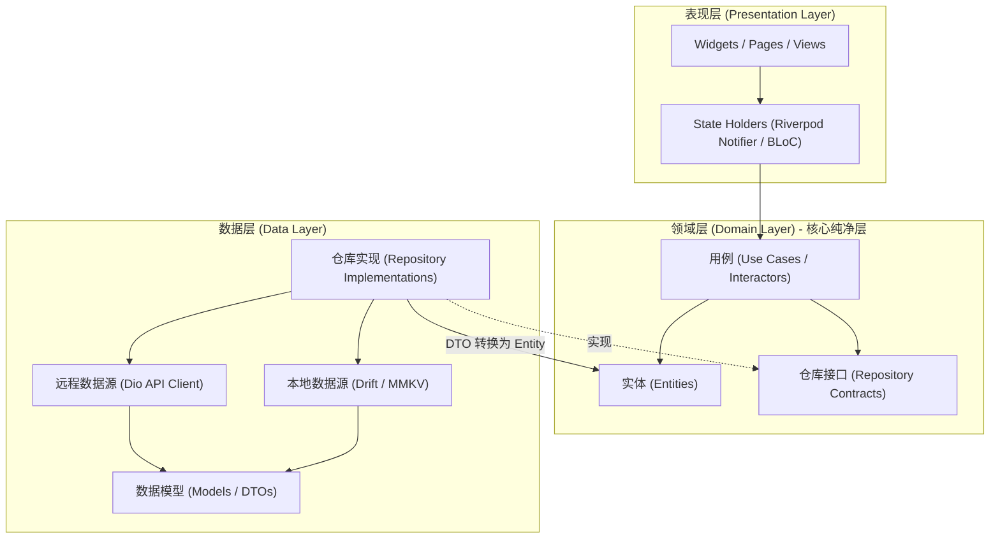

# 03 企业级 Clean Architecture 与分层设计

在企业级中大型项目或复杂跨端应用中，如果直接在 Widget 内发起网络请求、处理业务异常或拼接数据结构，代码将在两三个迭代后沦为无法测试、难以维护的“意大利面条代码（Spaghetti Code）”。

本篇将深入剖析如何将 **Clean Architecture（整洁架构）** 与 **领域驱动设计（DDD）** 思想落地于 Flutter，并结合 **依赖注入（`get_it`）** 与 **多环境（Flavor / `--dart-define`）** 构建出高扩展、可单测的工业级项目骨架。

---

## 1. 为什么选择 Clean Architecture？

Clean Architecture 的核心原则是**依赖反转原则（Dependency Inversion Principle）**：**内层的业务领域规则绝不依赖外层的具体技术实现（如 UI 库、HTTP 库或数据库）**。



### 三层核心职责定义：

| 层级 | 职责与技术边界 | 依赖规则 |
| :--- | :--- | :--- |
| **Domain Layer（领域层）** | 核心业务模型与纯业务规则。包含 **Entity**（纯业务实体）、**Use Case**（业务用例）和 **Repository 抽象接口**。 | **绝对纯净**：只依赖 Dart 标准库，严禁引入 `flutter/material.dart`、`dio` 等任何外部框架。 |
| **Data Layer（数据层）** | 数据的检索与持久化。包含 **RemoteDataSource**（API 通信）、**LocalDataSource**（本地存储）、**DTO/Model**（负责 JSON 序列化）以及 **Repository 具体实现**。 | 依赖 Domain 层（实现其接口），依赖外部基础设施库（Dio、Drift、Hive）。 |
| **Presentation Layer（表现层）** | UI 绘制与用户交互。包含 **Widgets/Pages** 与 **状态管理器（Riverpod / BLoC）**。 | 依赖 Domain 层（调用 UseCase 获取纯净数据），负责将业务状态转译为 UI 视图。 |

---

## 2. 核心分层代码实战（以用户登录与鉴权为例）

### 2.1 领域层 (Domain Layer)：定义纯净接口与实体

```dart
// lib/features/auth/domain/entities/user_entity.dart
class UserEntity {
  final String id;
  final String email;
  final String nickname;
  final bool isVip;

  const UserEntity({
    required this.id,
    required this.email,
    required this.nickname,
    required this.isVip,
  });
}

// lib/features/auth/domain/repositories/auth_repository.dart
// 仓库契约：只定义业务方法签名，不关心底层是 HTTP 请求还是读取本地缓存
abstract class AuthRepository {
  Future<UserEntity> loginWithPassword({
    required String account,
    required String password,
  });

  Future<void> logout();
  Future<UserEntity?> getCurrentUser();
}

// lib/features/auth/domain/usecases/login_usecase.dart
// 用例：一个类只做一件明确的业务动作，便于单元测试与逻辑复用
class LoginUseCase {
  final AuthRepository _repository;

  LoginUseCase(this._repository);

  Future<UserEntity> call({
    required String account,
    required String password,
  }) async {
    // 业务规则校验：如账号密码前置规则
    if (account.trim().isEmpty) {
      throw ArgumentError('Account cannot be empty');
    }
    if (password.length < 6) {
      throw ArgumentError('Password length must be at least 6');
    }

    return await _repository.loginWithPassword(
      account: account,
      password: password,
    );
  }
}
```

### 2.2 数据层 (Data Layer)：模型映射与数据源实现

```dart
// lib/features/auth/data/models/user_dto.dart
// DTO (Data Transfer Object)：专职负责 JSON 序列化与转换
import '../../domain/entities/user_entity.dart';

class UserDto {
  final String id;
  final String emailAddress;
  final String displayName;
  final int vipLevel;

  const UserDto({
    required this.id,
    required this.emailAddress,
    required this.displayName,
    required this.vipLevel,
  });

  factory UserDto.fromJson(Map<String, dynamic> json) {
    return UserDto(
      id: json['uid'] as String,
      emailAddress: json['email'] as String,
      displayName: json['display_name'] as String,
      vipLevel: json['vip_level'] as int? ?? 0,
    );
  }

  // 关键方法：将底层 DTO 转为领域层的纯洁 Entity
  UserEntity toEntity() {
    return UserEntity(
      id: id,
      email: emailAddress,
      nickname: displayName,
      isVip: vipLevel > 0,
    );
  }
}

// lib/features/auth/data/datasources/auth_remote_data_source.dart
abstract class AuthRemoteDataSource {
  Future<UserDto> login(String account, String password);
}

class AuthRemoteDataSourceImpl implements AuthRemoteDataSource {
  final Dio _dio;
  AuthRemoteDataSourceImpl(this._dio);

  @override
  Future<UserDto> login(String account, String password) async {
    final response = await _dio.post(
      '/api/v1/auth/login',
      data: {'account': account, 'password': password},
    );
    return UserDto.fromJson(response.data as Map<String, dynamic>);
  }
}

// lib/features/auth/data/repositories/auth_repository_impl.dart
import '../../domain/repositories/auth_repository.dart';
import '../../domain/entities/user_entity.dart';

class AuthRepositoryImpl implements AuthRepository {
  final AuthRemoteDataSource _remoteDataSource;
  final AuthLocalDataSource _localDataSource;

  AuthRepositoryImpl({
    required AuthRemoteDataSource remoteDataSource,
    required AuthLocalDataSource localDataSource,
  })  : _remoteDataSource = remoteDataSource,
        _localDataSource = localDataSource;

  @override
  Future<UserEntity> loginWithPassword({
    required String account,
    required String password,
  }) async {
    // 1. 调用远程数据源
    final dto = await _remoteDataSource.login(account, password);
    // 2. 缓存本地 Token
    await _localDataSource.saveToken(dto.id);
    // 3. 转换为纯净 Entity 交付上层
    return dto.toEntity();
  }

  @override
  Future<void> logout() async => await _localDataSource.clearSession();

  @override
  Future<UserEntity?> getCurrentUser() async {
    final cached = await _localDataSource.getCachedUser();
    return cached?.toEntity();
  }
}
```

---

## 3. 依赖注入（Dependency Injection）架构

在大型 Flutter 项目中，绝不能在每个类里使用 `new AuthRepositoryImpl()`，否则会导致代码高度耦合且无法编写 Mock 测试。工业界最常用的服务定位与依赖注入容器是 **`get_it`**。

### 3.1 容器配置与依赖装配

```dart
// lib/core/di/service_locator.dart
import 'package:get_it/get_it.dart';
import 'package:dio/dio.dart';

final sl = GetIt.instance; // sl 代表 Service Locator

Future<void> setupServiceLocator() async {
  // 1. 注册核心基础外部服务 (External / Core)
  sl.registerLazySingleton<Dio>(() {
    final dio = Dio(BaseOptions(
      baseUrl: AppEnvironment.current.apiBaseUrl,
      connectTimeout: const Duration(seconds: 15),
      receiveTimeout: const Duration(seconds: 15),
    ));
    // 挂载拦截器等
    return dio;
  });

  // 2. 注册数据源 (Data Sources)
  sl.registerLazySingleton<AuthRemoteDataSource>(
    () => AuthRemoteDataSourceImpl(sl<Dio>()),
  );
  sl.registerLazySingleton<AuthLocalDataSource>(
    () => AuthLocalDataSourceImpl(),
  );

  // 3. 注册仓库 (Repositories) - 绑定抽象接口到具体实现
  sl.registerLazySingleton<AuthRepository>(
    () => AuthRepositoryImpl(
      remoteDataSource: sl<AuthRemoteDataSource>(),
      localDataSource: sl<AuthLocalDataSource>(),
    ),
  );

  // 4. 注册用例 (Use Cases)
  sl.registerFactory<LoginUseCase>(
    () => LoginUseCase(sl<AuthRepository>()),
  );
}
```

> [!NOTE]
> - `registerLazySingleton`：懒汉单例。第一次通过 `sl<T>()` 请求时才实例化，全局共享同一对象。
> - `registerFactory`：工厂注入。每次请求都会生成新的实例对象，非常适合持有不同生命周期的 UI 状态控制器或 UseCase。

---

## 4. 多环境配置管理（Flavor 与 `--dart-define`）

企业级开发必须严格隔离开发（`dev`）、预发布（`staging`）和生产（`prod`）环境的 API 域名、App 名称、包名（Bundle ID）以及第三方 SDK AppKey。

### 4.1 现代推荐方案：`--dart-define-from-file`

从 Flutter 3.7 开始，官方推荐使用 JSON 配置文件配合 `--dart-define-from-file`，既能消除在命令行输入超长参数的麻烦，又便于 CI/CD 自动化集成：

#### 1. 定义环境配置 JSON

```json
// env/env_dev.json
{
  "ENVIRONMENT": "development",
  "API_BASE_URL": "https://api-dev.enterprise.com",
  "ENABLE_HTTP_LOG": true,
  "TIMEOUT_MS": 15000
}

// env/env_prod.json
{
  "ENVIRONMENT": "production",
  "API_BASE_URL": "https://api.enterprise.com",
  "ENABLE_HTTP_LOG": false,
  "TIMEOUT_MS": 8000
}
```

#### 2. 在 Dart 中解析环境变量

```dart
// lib/core/config/app_environment.dart
enum EnvType { dev, staging, prod }

class AppEnvironment {
  final EnvType envType;
  final String apiBaseUrl;
  final bool enableHttpLog;
  final int timeoutMs;

  static late final AppEnvironment current;

  const AppEnvironment._({
    required this.envType,
    required this.apiBaseUrl,
    required this.enableHttpLog,
    required this.timeoutMs,
  });

  static void initialize() {
    // 从编译期环境中读取字符串
    const envString = String.fromEnvironment('ENVIRONMENT', defaultValue: 'development');
    const baseUrl = String.fromEnvironment('API_BASE_URL', defaultValue: 'https://api-dev.enterprise.com');
    const enableLog = bool.fromEnvironment('ENABLE_HTTP_LOG', defaultValue: true);
    const timeout = int.fromEnvironment('TIMEOUT_MS', defaultValue: 15000);

    final type = switch (envString) {
      'production' => EnvType.prod,
      'staging' => EnvType.staging,
      _ => EnvType.dev,
    };

    current = AppEnvironment._(
      envType: type,
      apiBaseUrl: baseUrl,
      enableHttpLog: enableLog,
      timeoutMs: timeout,
    );
  }
}
```

#### 3. 启动命令与 VS Code 配置

```bash
# 命令行运行不同环境
flutter run --dart-define-from-file=env/env_dev.json
flutter build apk --dart-define-from-file=env/env_prod.json
```

```json
// .vscode/launch.json 启动调试配置
{
  "version": "0.2.0",
  "configurations": [
    {
      "name": "Flutter: Dev Environment",
      "request": "launch",
      "type": "dart",
      "args": ["--dart-define-from-file=env/env_dev.json"]
    },
    {
      "name": "Flutter: Production Environment",
      "request": "launch",
      "type": "dart",
      "args": ["--dart-define-from-file=env/env_prod.json"]
    }
  ]
}
```

---

## 5. 企业级项目目录树规范（Feature-First）

在大规模团队协作中，**按功能垂直切分（Feature-First）** 远优于传统的按技术层横向切分（Layer-First），能大幅减少 Git 代码冲突并提升模块自治性：

```
lib/
├── core/                                 # 全局公共核心能力
│   ├── config/                           # 环境参数、全局常量
│   ├── di/                               # 依赖注入容器装配 (get_it)
│   ├── network/                          # Dio 客户端、全局拦截器、统一错误处理器
│   ├── theme/                            # ThemeData、颜色资产、排版规范
│   ├── utils/                            # 通用工具类 (加密、日期、格式化)
│   └── widgets/                          # 全局基础 UI 组件库 (通用按钮、骨架屏、空视图)
│
├── features/                             # 业务功能模块垂直划分
│   ├── auth/                             # 认证功能域
│   │   ├── domain/                       # 领域层 (纯净业务)
│   │   │   ├── entities/                 # UserEntity, TokenEntity
│   │   │   ├── repositories/             # AuthRepository 抽象接口
│   │   │   └── usecases/                 # LoginUseCase, LogoutUseCase
│   │   ├── data/                         # 数据层
│   │   │   ├── datasources/              # RemoteDataSource, LocalDataSource
│   │   │   ├── models/                   # UserDto, TokenDto
│   │   │   └── repositories/             # AuthRepositoryImpl
│   │   └── presentation/                 # 表现层
│   │       ├── controllers/              # Riverpod Notifier 或 BLoC
│   │       ├── pages/                    # LoginPage, RegisterPage
│   │       └── widgets/                  # LoginHeaderWidget, AuthTextField
│   │
│   ├── order/                            # 订单功能域 (同上结构)
│   └── user_profile/                     # 个人中心功能域 (同上结构)
│
├── bootstrap.dart                        # 统一引导器 (全局异常守卫、DI 注册、环境初始化)
└── main.dart                             # 应用程序主入口
```

---

## 6. 统一启动引导器实现

避免在 `main.dart` 中堆砌杂乱的初始化逻辑，推荐使用统一的 `bootstrap.dart` 封装：

```dart
// lib/bootstrap.dart
import 'dart:async';
import 'package:flutter/material.dart';
import 'core/config/app_environment.dart';
import 'core/di/service_locator.dart';

Future<void> bootstrap(Widget Function() builder) async {
  // 保证 Flutter 引擎与原生通信信道初始化完毕
  WidgetsFlutterBinding.ensureInitialized();

  // 1. 初始化环境变量
  AppEnvironment.initialize();

  // 2. 依赖注入装配
  await setupServiceLocator();

  // 3. 全局未捕获异常监控网 (将在第 09 篇详述)
  FlutterError.onError = (details) {
    FlutterError.presentError(details);
    // 上报到 APM 监控
  };

  runApp(builder());
}

// lib/main.dart
import 'package:flutter/material.dart';
import 'bootstrap.dart';

void main() {
  bootstrap(() => const EnterpriseAppRoot());
}

class EnterpriseAppRoot extends StatelessWidget {
  const EnterpriseAppRoot({super.key});

  @override
  Widget build(BuildContext context) {
    return MaterialApp(
      title: 'Enterprise Cross-Platform App',
      theme: ThemeData(useMaterial3: true),
      home: const Scaffold(
        body: Center(child: Text('Enterprise Core Ready')),
      ),
    );
  }
}
```

---

## 7. 架构总结

- **依赖单向流动**：`Presentation -> Domain <- Data`，Domain 层作为系统的神经中枢，绝不妥协任何外部污染。
- **解耦利器**：依托 `get_it` 实现面向接口编程，测试时可随意将 `AuthRepository` 替换为 `MockAuthRepository`。
- **配置隔离**：通过 `--dart-define-from-file` 彻底分离敏感环境配置与代码仓库，保障 CI/CD 构建安全性。

---

## 8. 官方权威参考资料 (docs.flutter.cn)

- [Flutter 架构与核心分层概览](https://docs.flutter.cn/resources/architectural-overview)
- [使用 dart-define 配置多环境与构建参数](https://docs.flutter.cn/deployment/flavors)
- [Dart 代码包与模块化工程规范](https://dart.cn/tools/pub/package-layout)

