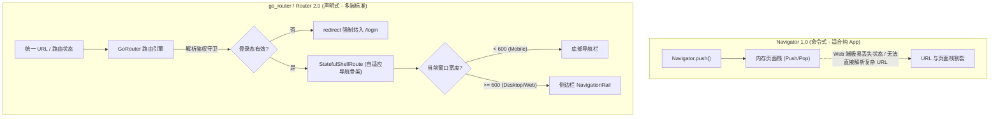

# 06 复杂导航路由与多端响应式适配

在跨端全平台开发中（Mobile + Web + Desktop），路由与屏幕适配是直接决定用户体验的核心生命线：
- **在 Web / 桌面端**：用户习惯于浏览器 URL 直达、前进后退、侧边导航栏（Navigation Rail）与键鼠快捷键交互；
- **在移动端**：用户依赖手势滑动返回、底部导航栏（Bottom Navigation Bar）与流式触控。

本篇将深入剖析官方推荐的声明式路由标准 **`go_router`**，构建**鉴权守卫**、**嵌套路由（`StatefulShellRoute`）**，并落地工业级的**多端响应式断点系统**与**键鼠深度交互适配**。

---

## 1. 路由体系：从 Navigator 1.0 到 go_router



---

## 2. 生产级 go_router 声明式路由与鉴权守卫

### 2.1 引入依赖与配置 Web 路径模式

```yaml
dependencies:
  go_router: ^14.2.0
  flutter_web_plugins: # 用于消除 Web 端 URL 中的 '#' 哈希符号
    sdk: flutter
```

在 `main.dart` 中抹除 Web 端的 `#`（启用 HTML5 History 路由模式）：

```dart
import 'package:flutter_web_plugins/url_strategy.dart';

void main() {
  // 必须在 runApp 之前调用，开启 HTML5 History 路由风格
  usePathUrlStrategy();
  runApp(const MyApp());
}
```

### 2.2 嵌套导航与全局鉴权守卫完整实现

使用 `StatefulShellRoute.indexedStack` 可以确保用户在不同 Tab（如首页、数据大屏、个人设置）之间切换时，**各个 Tab 的滚动位置和本地状态完全保留，绝不销毁重建**：

```dart
// lib/core/router/app_router.dart
import 'package:flutter/material.dart';
import 'package:go_router/go_router.dart';
import '../auth/auth_state_notifier.dart';

class AppRouter {
  final AuthStateNotifier authNotifier;

  AppRouter(this.authNotifier);

  late final GoRouter router = GoRouter(
    initialLocation: '/home',
    // 监听全局登录态流，登录状态一改变自动重新执行 redirect 守卫
    refreshListenable: authNotifier,
    
    // 全局路由守卫 (Auth Guard)
    redirect: (BuildContext context, GoRouterState state) {
      final isLoggedIn = authNotifier.isLoggedIn;
      final isLoggingIn = state.matchedLocation == '/login';

      // 1. 未登录且访问受保护页面：强制重定向到登录页，并保留原目标路径以便登录后回跳
      if (!isLoggedIn && !isLoggingIn) {
        final fromPath = state.uri.toString();
        return '/login?from=\${Uri.encodeComponent(fromPath)}';
      }

      // 2. 已登录但试图访问登录页：重定向到主页
      if (isLoggedIn && isLoggingIn) {
        return '/home';
      }

      return null; // 允许正常放行
    },

    routes: [
      GoRoute(
        path: '/login',
        builder: (context, state) {
          final redirectUrl = state.uri.queryParameters['from'];
          return LoginPage(redirectUrl: redirectUrl);
        },
      ),

      // 嵌套导航骨架：自适应承载多个主 Tab 页面
      StatefulShellRoute.indexedStack(
        builder: (context, state, navigationShell) {
          // ResponsiveScaffold 将在后续步骤实现：自动在移动端展示底部栏，大屏展示侧边栏
          return AdaptiveRootScaffold(navigationShell: navigationShell);
        },
        branches: [
          // 分支 1：主页
          StatefulShellBranch(
            routes: [
              GoRoute(
                path: '/home',
                builder: (context, state) => const HomePage(),
                routes: [
                  // 详情页：作为二级子路由
                  GoRoute(
                    path: 'detail/:id',
                    builder: (context, state) {
                      final id = state.pathParameters['id']!;
                      return DetailPage(itemId: id);
                    },
                  ),
                ],
              ),
            ],
          ),
          // 分支 2：控制台 / 数据分析
          StatefulShellBranch(
            routes: [
              GoRoute(
                path: '/analytics',
                builder: (context, state) => const AnalyticsPage(),
              ),
            ],
          ),
          // 分支 3：系统设置
          StatefulShellBranch(
            routes: [
              GoRoute(
                path: '/settings',
                builder: (context, state) => const SettingsPage(),
              ),
            ],
          ),
        ],
      ),
    ],
  );
}
```

---

## 3. 企业级多端响应式断点系统

在跨端多平台适配中，通常依赖统一的屏幕断点规范编写响应式界面。Flutter 官方 Material 3 同样定义了标准断点：

```dart
// lib/core/responsive/breakpoints.dart
import 'package:flutter/material.dart';

enum DeviceScreenType {
  compact,  // 移动端手机 (< 600dp)
  medium,   // 平板竖屏 / 大折叠屏 (600dp ~ 840dp)
  expanded, // 桌面端 / 平板横屏 / Web 宽屏 (> 840dp)
}

class Breakpoints {
  static const double compactMaxWidth = 600.0;
  static const double mediumMaxWidth = 840.0;

  static DeviceScreenType getScreenType(BuildContext context) {
    final width = MediaQuery.sizeOf(context).width;
    if (width < compactMaxWidth) {
      return DeviceScreenType.compact;
    } else if (width < mediumMaxWidth) {
      return DeviceScreenType.medium;
    } else {
      return DeviceScreenType.expanded;
    }
  }

  static bool isMobile(BuildContext context) =>
      getScreenType(context) == DeviceScreenType.compact;

  static bool isDesktopOrWeb(BuildContext context) =>
      getScreenType(context) == DeviceScreenType.expanded;
}
```

### 3.1 响应式布局构建器 (ResponsiveLayoutBuilder)

```dart
// lib/core/responsive/responsive_layout_builder.dart
import 'package:flutter/material.dart';
import 'breakpoints.dart';

class ResponsiveLayoutBuilder extends StatelessWidget {
  final WidgetBuilder compact;
  final WidgetBuilder? medium;
  final WidgetBuilder expanded;

  const ResponsiveLayoutBuilder({
    super.key,
    required this.compact,
    this.medium,
    required this.expanded,
  });

  @override
  Widget build(BuildContext context) {
    return LayoutBuilder(
      builder: (context, constraints) {
        if (constraints.maxWidth < Breakpoints.compactMaxWidth) {
          return compact(context);
        } else if (constraints.maxWidth < Breakpoints.mediumMaxWidth) {
          return (medium ?? expanded)(context);
        } else {
          return expanded(context);
        }
      },
    );
  }
}
```

---

## 4. 自适应主导航骨架（Adaptive Navigation Scaffold）

以下组件实现：**手机端自动使用 BottomNavigationBar，平板端自动切换为 NavigationRail，桌面/宽屏端自动展开带文字标签的侧边导航抽屉**。

```dart
// lib/core/responsive/adaptive_root_scaffold.dart
import 'package:flutter/material.dart';
import 'package:go_router/go_router.dart';
import 'breakpoints.dart';

class AdaptiveRootScaffold extends StatelessWidget {
  final StatefulNavigationShell navigationShell;

  const AdaptiveRootScaffold({
    super.key,
    required this.navigationShell,
  });

  void _onDestinationSelected(int index) {
    // 切换 Tab 时如果点击当前项，支持滚动回到顶部；不同项则平滑切换分支
    navigationShell.goBranch(
      index,
      initialLocation: index == navigationShell.currentIndex,
    );
  }

  @override
  Widget build(BuildContext context) {
    final screenType = Breakpoints.getScreenType(context);

    // 1. 移动端手机：展示标准底部栏
    if (screenType == DeviceScreenType.compact) {
      return Scaffold(
        body: navigationShell,
        bottomNavigationBar: NavigationBar(
          selectedIndex: navigationShell.currentIndex,
          onDestinationSelected: _onDestinationSelected,
          destinations: const [
            NavigationDestination(icon: Icon(Icons.home_outlined), selectedIcon: Icon(Icons.home), label: '主页'),
            NavigationDestination(icon: Icon(Icons.analytics_outlined), selectedIcon: Icon(Icons.analytics), label: '分析'),
            NavigationDestination(icon: Icon(Icons.settings_outlined), selectedIcon: Icon(Icons.settings), label: '设置'),
          ],
        ),
      );
    }

    // 2. 桌面与平板端：侧边栏 + 内容区水平并排排版
    final isExpanded = screenType == DeviceScreenType.expanded;

    return Scaffold(
      body: Row(
        children: [
          NavigationRail(
            extended: isExpanded, // 桌面端宽屏展开显示文字标签，平板仅显示图标
            minExtendedWidth: 200,
            selectedIndex: navigationShell.currentIndex,
            onDestinationSelected: _onDestinationSelected,
            leading: Padding(
              padding: const EdgeInsets.symmetric(vertical: 16),
              child: Icon(Icons.dashboard_customize, size: isExpanded ? 36 : 28, color: Theme.of(context).colorScheme.primary),
            ),
            destinations: const [
              NavigationRailDestination(icon: Icon(Icons.home_outlined), selectedIcon: Icon(Icons.home), label: Text('主页')),
              NavigationRailDestination(icon: Icon(Icons.analytics_outlined), selectedIcon: Icon(Icons.analytics), label: Text('数据分析')),
              NavigationRailDestination(icon: Icon(Icons.settings_outlined), selectedIcon: Icon(Icons.settings), label: Text('系统设置')),
            ],
          ),
          const VerticalDivider(thickness: 1, width: 1),
          // 主展示内容区填满剩余所有宽度
          Expanded(child: navigationShell),
        ],
      ),
    );
  }
}
```

---

## 5. Master-Detail（主从列表）桌面响应式布局实操

在移动端上，点击列表项是进入全新的页面（`Navigator.push`）；而在平板和桌面端上，主流交互是**左侧常驻列表，右侧直接联动显示详情卡片**：

```dart
// lib/features/order/presentation/pages/responsive_order_page.dart
import 'package:flutter/material.dart';
import '../../../../core/responsive/breakpoints.dart';

class ResponsiveOrderPage extends StatefulWidget {
  const ResponsiveOrderPage({super.key});

  @override
  State<ResponsiveOrderPage> createState() => _ResponsiveOrderPageState();
}

class _ResponsiveOrderPageState extends State<ResponsiveOrderPage> {
  String? _selectedOrderId;

  @override
  Widget build(BuildContext context) {
    final isDesktop = Breakpoints.isDesktopOrWeb(context);

    // 列表构建逻辑
    final listView = ListView.builder(
      itemCount: 20,
      itemBuilder: (context, index) {
        final orderId = 'ORD_2026_$index';
        final isSelected = _selectedOrderId == orderId;
        return ListTile(
          selected: isDesktop && isSelected,
          selectedTileColor: Theme.of(context).colorScheme.primaryContainer.withOpacity(0.3),
          title: Text('订单号: $orderId'),
          subtitle: const Text('已付款 · 顺丰速运'),
          onTap: () {
            if (isDesktop) {
              // 桌面端：只更新右侧面板关联的 ID
              setState(() => _selectedOrderId = orderId);
            } else {
              // 移动端：普通全屏路由入栈
              Navigator.of(context).push(
                MaterialPageRoute(builder: (_) => MobileOrderDetailPage(orderId: orderId)),
              );
            }
          },
        );
      },
    );

    // 桌面端双栏分屏呈现
    if (isDesktop) {
      return Scaffold(
        appBar: AppBar(title: const Text('订单工作台 (Desktop Master-Detail)')),
        body: Row(
          children: [
            SizedBox(width: 360, child: listView),
            const VerticalDivider(width: 1),
            Expanded(
              child: _selectedOrderId == null
                  ? const Center(child: Text('请从左侧选择订单以查看详情'))
                  : OrderDetailContentPanel(orderId: _selectedOrderId!),
            ),
          ],
        ),
      );
    }

    // 移动端单栏呈现
    return Scaffold(
      appBar: AppBar(title: const Text('订单列表')),
      body: listView,
    );
  }
}

class OrderDetailContentPanel extends StatelessWidget {
  final String orderId;
  const OrderDetailContentPanel({super.key, required this.orderId});

  @override
  Widget build(BuildContext context) {
    return Padding(
      padding: const EdgeInsets.all(24.0),
      child: Card(
        child: Padding(
          padding: const EdgeInsets.all(24.0),
          child: Column(
            crossAxisAlignment: CrossAxisAlignment.start,
            children: [
              Text('订单详情: $orderId', style: Theme.of(context).textTheme.headlineMedium),
              const Divider(height: 32),
              const Text('物流状态: 运输中'),
              const SizedBox(height: 12),
              const Text('配送地址: 深圳市南山区科技园腾讯大厦'),
            ],
          ),
        ),
      ),
    );
  }
}

class MobileOrderDetailPage extends StatelessWidget {
  final String orderId;
  const MobileOrderDetailPage({super.key, required this.orderId});

  @override
  Widget build(BuildContext context) {
    return Scaffold(
      appBar: AppBar(title: Text(orderId)),
      body: OrderDetailContentPanel(orderId: orderId),
    );
  }
}
```

---

## 6. Web 与桌面端深度交互优化

### 6.1 鼠标悬浮与光标反馈 (MouseRegion)

在桌面与 Web 端中，鼠标指针在交互元素上通常需要显式呈现 `:hover` 悬停反馈与 `cursor: pointer` 手型光标。在 Flutter 中，若直接使用普通 `GestureDetector`，鼠标滑过不会变成手型光标。企业级应用必须提供严密的鼠标状态反馈：

```dart
class EnterpriseInteractiveCard extends StatefulWidget {
  final Widget child;
  final VoidCallback onTap;

  const EnterpriseInteractiveCard({super.key, required this.child, required this.onTap});

  @override
  State<EnterpriseInteractiveCard> createState() => _EnterpriseInteractiveCardState();
}

class _EnterpriseInteractiveCardState extends State<EnterpriseInteractiveCard> {
  bool _isHovered = false;

  @override
  Widget build(BuildContext context) {
    return MouseRegion(
      cursor: SystemMouseCursors.click, // 悬停自动变为小手光标
      onEnter: (_) => setState(() => _isHovered = true),
      onExit: (_) => setState(() => _isHovered = false),
      child: GestureDetector(
        onTap: widget.onTap,
        child: AnimatedContainer(
          duration: const Duration(milliseconds: 180),
          transform: _isHovered ? (Matrix4.identity()..translate(0, -4, 0)) : Matrix4.identity(),
          decoration: BoxDecoration(
            borderRadius: BorderRadius.circular(12),
            boxShadow: _isHovered
                ? [BoxShadow(color: Colors.black.withOpacity(0.12), blurRadius: 16, offset: const Offset(0, 8))]
                : [BoxShadow(color: Colors.black.withOpacity(0.04), blurRadius: 4, offset: const Offset(0, 2))],
          ),
          child: widget.child,
        ),
      ),
    );
  }
}
```

### 6.2 键盘快捷键监听 (Shortcuts & Actions)

为桌面端与 Web 端提供沉浸式键盘快捷键操作（如 `Ctrl + S` 保存，`ESC` 取消）：

```dart
class SaveIntent extends Intent {
  const SaveIntent();
}

Widget buildShortcutContainer({required Widget child, required VoidCallback onSave}) {
  return Shortcuts(
    shortcuts: <ShortcutActivator, Intent>{
      LogicalKeySet(LogicalKeyboardKey.control, LogicalKeyboardKey.keyS): const SaveIntent(),
      LogicalKeySet(LogicalKeyboardKey.meta, LogicalKeyboardKey.keyS): const SaveIntent(), // macOS Command + S
    },
    child: Actions(
      actions: <Type, Action<Intent>>{
        SaveIntent: CallbackAction<SaveIntent>(onInvoke: (intent) => onSave()),
      },
      child: Focus(
        autofocus: true,
        child: child,
      ),
    ),
  );
}
```

### 6.3 官方 WebAssembly (WASM) 部署生产环境配置约束

根据 [Flutter Web 官方规范 (docs.flutter.cn/platform-integration/web/wasm)](https://docs.flutter.cn/platform-integration/web/wasm)，在构建生产级 Web 应用时启用 WASM（`flutter build web --wasm`）可换取比旧版 JavaScript/CanvasKit 提升 2~3 倍的帧率与更小的包体积。

> [!IMPORTANT]
> **生产 Nginx / CDN 响应头硬性要求**：
> 浏览器运行多线程 WebAssembly 时要求启用 `SharedArrayBuffer`。托管静态资源的 Web 服务器**必须显式下发以下两个 HTTP 响应头**，否则页面将直接无法启动：
> ```nginx
> # Nginx 生产配置示例
> server {
>     listen 443 ssl http2;
>     server_name web.enterprise.com;
>     
>     # 必须配置跨源隔离响应头 (Cross-Origin Isolation)
>     add_header Cross-Origin-Embedder-Policy require-corp;
>     add_header Cross-Origin-Opener-Policy same-origin;
> 
>     location / {
>         root /var/www/flutter_web_dist;
>         try_files $uri $uri/ /index.html; # 支持 History 模式
>     }
> }
> ```

---

## 7. 架构总结

1. **路由选型定海神针**：坚定采用 `go_router`，通过 `refreshListenable` 联动鉴权实体实现自动化守卫。
2. **Tab 状态持久化**：使用 `StatefulShellRoute.indexedStack` 彻底消灭 Tab 切换丢状态的体验缺陷。
3. **断点先行**：以 600dp 与 840dp 为金标准基线，结合 `LayoutBuilder` 实现 Master-Detail 自动折叠与展开。
4. **桌面原生级质感**：必须针对鼠标悬浮（`MouseRegion`）、右键上下文菜单与键盘快捷键进行系统化增强。
5. **Web 部署隔离规范**：启用 WASM 构建时，务必在 Web 宿主服务配置 COOP 和 COEP 响应头。

---

## 8. 官方权威参考资料 (docs.flutter.cn)

- [Flutter 声明式路由与导航架构](https://docs.flutter.cn/ui/navigation)
- [go_router 官方深入指南与参数手册](https://pub.dev/packages/go_router)
- [WebAssembly (WASM) 生产编译与部署规范](https://docs.flutter.cn/platform-integration/web/wasm)
- [多平台自适应与响应式设计 (Adaptive Apps)](https://docs.flutter.cn/ui/adaptive-responsive)

