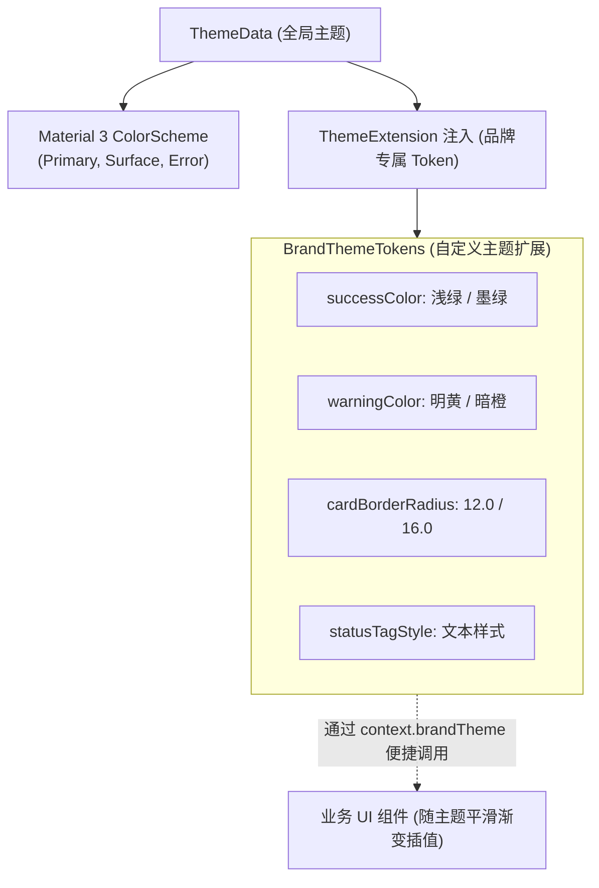

# 07 企业级设计系统与通用组件库封装

在大型跨端工程中，企业通常会沉淀一套自研或基于行业标准的 Design System。在 Flutter 跨端开发中，仅靠 Material 默认组件无法满足大厂品牌定制、动态主题换肤、复杂表单校验与高性能分页列表的要求。

本篇将深入剖析基于 **Material 3** 规范的 **`ThemeExtension` 品牌资产扩展机制**，并手把手实现两套高频业务核心轮子：**企业级高性能通用分页列表组件** 与 **声明式响应式表单校验引擎**。

---

## 1. 企业级设计系统与 ThemeExtension

### 1.1 为什么必须使用 ThemeExtension？

Flutter 原生的 `ThemeData` 仅提供了 Material 3 的标准色板（如 `primary`, `secondary`, `error`）。然而，在真实企业应用中，设计团队往往有诸如 `warningColor`、`successColor`、`badgeColor` 以及多套卡片圆角和阴影规范。

过去常见的“全局静态颜色类（如 `AppColors.brandRed`）”**无法响应深色模式（Dark Mode）与动态换肤切换**。官方推荐的工业级方案是 **`ThemeExtension<T>`**：



### 1.2 生产级 BrandThemeExtension 源码实战

```dart
// lib/core/theme/brand_theme_extension.dart
import 'package:flutter/material.dart';

@immutable
class BrandThemeExtension extends ThemeExtension<BrandThemeExtension> {
  final Color successColor;
  final Color warningColor;
  final Color infoColor;
  final double cardRadius;

  const BrandThemeExtension({
    required this.successColor,
    required this.warningColor,
    required this.infoColor,
    required this.cardRadius,
  });

  // 1. 浅色主题资产
  static const light = BrandThemeExtension(
    successColor: Color(0xFF52C41A),
    warningColor: Color(0xFFFAAD14),
    infoColor: Color(0xFF1890FF),
    cardRadius: 12.0,
  );

  // 2. 深色主题资产
  static const dark = BrandThemeExtension(
    successColor: Color(0xFF49AA19),
    warningColor: Color(0xFFD89614),
    infoColor: Color(0xFF177DDC),
    cardRadius: 12.0,
  );

  @override
  BrandThemeExtension copyWith({
    Color? successColor,
    Color? warningColor,
    Color? infoColor,
    double? cardRadius,
  }) {
    return BrandThemeExtension(
      successColor: successColor ?? this.successColor,
      warningColor: warningColor ?? this.warningColor,
      infoColor: infoColor ?? this.infoColor,
      cardRadius: cardRadius ?? this.cardRadius,
    );
  }

  // 3. 必须实现 lerp 方法：在用户切换明暗主题时，支持颜色与尺寸的平滑线性插值过渡！
  @override
  BrandThemeExtension lerp(ThemeExtension<BrandThemeExtension>? other, double t) {
    if (other is! BrandThemeExtension) return this;
    return BrandThemeExtension(
      successColor: Color.lerp(successColor, other.successColor, t)!,
      warningColor: Color.lerp(warningColor, other.warningColor, t)!,
      infoColor: Color.lerp(infoColor, other.infoColor, t)!,
      cardRadius: cardRadius + (other.cardRadius - cardRadius) * t,
    );
  }
}

// 语法糖：为 BuildContext 挂载便捷访问器
extension BuildContextThemeExtension on BuildContext {
  BrandThemeExtension get brandTheme =>
      Theme.of(this).extension<BrandThemeExtension>() ?? BrandThemeExtension.light;
}
```

### 1.3 装配全局主题

```dart
// lib/core/theme/app_theme.dart
import 'package:flutter/material.dart';
import 'brand_theme_extension.dart';

class AppTheme {
  static ThemeData get lightTheme => ThemeData(
        useMaterial3: true,
        brightness: Brightness.light,
        colorSchemeSeed: const Color(0xFF0052D9),
        extensions: const [BrandThemeExtension.light],
      );

  static ThemeData get darkTheme => ThemeData(
        useMaterial3: true,
        brightness: Brightness.dark,
        colorSchemeSeed: const Color(0xFF0052D9),
        extensions: const [BrandThemeExtension.dark],
      );
}

// 在 Widget 中消费：
// final successColor = context.brandTheme.successColor;
```

---

## 2. 通用高性能分页列表组件（EnterprisePagedListView）

在任何管理后台、社交资讯或电商 App 中，**下拉刷新、上拉加载更多、首屏骨架屏、网络异常重试、空数据占位**是每个业务列表的刚需。以下组件封装了统一的滚动监听与状态流转：

```dart
// lib/core/widgets/enterprise_paged_list_view.dart
import 'package:flutter/material.dart';

typedef ItemWidgetBuilder<T> = Widget Function(BuildContext context, T item, int index);
typedef PagedDataFetcher<T> = Future<List<T>> Function(int pageIndex, int pageSize);

class EnterprisePagedListView<T> extends StatefulWidget {
  final PagedDataFetcher<T> onFetchPage;
  final ItemWidgetBuilder<T> itemBuilder;
  final int pageSize;
  final Widget? emptyPlaceholder;
  final EdgeInsetsGeometry padding;

  const EnterprisePagedListView({
    super.key,
    required this.onFetchPage,
    required this.itemBuilder,
    this.pageSize = 20,
    this.emptyPlaceholder,
    this.padding = EdgeInsets.zero,
  });

  @override
  State<EnterprisePagedListView<T>> createState() => _EnterprisePagedListViewState<T>();
}

class _EnterprisePagedListViewState<T> extends State<EnterprisePagedListView<T>> {
  final List<T> _items = [];
  final ScrollController _scrollController = ScrollController();
  
  int _currentPage = 1;
  bool _isFirstLoading = true;
  bool _isLoadingMore = false;
  bool _hasMore = true;
  String? _errorMessage;

  @override
  void initState() {
    super.initState();
    _loadFirstPage();
    _scrollController.addListener(_onScroll);
  }

  @override
  void dispose() {
    _scrollController.dispose();
    super.dispose();
  }

  void _onScroll() {
    // 距离底部还剩 200 逻辑像素时，自动预加载下一页
    if (_scrollController.position.pixels >= _scrollController.position.maxScrollExtent - 200) {
      if (!_isLoadingMore && _hasMore && _errorMessage == null) {
        _loadNextPage();
      }
    }
  }

  Future<void> _loadFirstPage() async {
    setState(() {
      _isFirstLoading = true;
      _errorMessage = null;
      _currentPage = 1;
      _hasMore = true;
    });

    try {
      final data = await widget.onFetchPage(_currentPage, widget.pageSize);
      setState(() {
        _items.clear();
        _items.addAll(data);
        _hasMore = data.length >= widget.pageSize;
        _isFirstLoading = false;
      });
    } catch (e) {
      setState(() {
        _errorMessage = e.toString();
        _isFirstLoading = false;
      });
    }
  }

  Future<void> _loadNextPage() async {
    setState(() => _isLoadingMore = true);
    try {
      final nextPage = _currentPage + 1;
      final data = await widget.onFetchPage(nextPage, widget.pageSize);
      setState(() {
        _items.addAll(data);
        _currentPage = nextPage;
        _hasMore = data.length >= widget.pageSize;
        _isLoadingMore = false;
      });
    } catch (e) {
      setState(() => _isLoadingMore = false);
      // 上拉失败可通过弹条弱提示，不遮挡已有数据
      if (mounted) {
        ScaffoldMessenger.of(context).showSnackBar(
          SnackBar(content: Text('加载更多失败: $e')),
        );
      }
    }
  }

  @override
  Widget build(BuildContext context) {
    // 1. 首屏全屏加载态
    if (_isFirstLoading) {
      return const Center(child: CircularProgressIndicator());
    }

    // 2. 首屏加载失败态
    if (_errorMessage != null && _items.isEmpty) {
      return Center(
        child: Column(
          mainAxisSize: MainAxisSize.min,
          children: [
            const Icon(Icons.cloud_off, size: 64, color: Colors.grey),
            const SizedBox(height: 16),
            Text('数据加载失败: $_errorMessage'),
            const SizedBox(height: 12),
            ElevatedButton(onPressed: _loadFirstPage, child: const Text('重试')),
          ],
        ),
      );
    }

    // 3. 空数据占位态
    if (_items.isEmpty) {
      return RefreshIndicator(
        onRefresh: _loadFirstPage,
        child: SingleChildScrollView(
          physics: const AlwaysScrollableScrollPhysics(),
          child: SizedBox(
            height: MediaQuery.sizeOf(context).height * 0.7,
            child: widget.emptyPlaceholder ?? const Center(child: Text('暂无相关数据')),
          ),
        ),
      );
    }

    // 4. 正常列表渲染 + 下拉刷新包裹
    return RefreshIndicator(
      onRefresh: _loadFirstPage,
      child: ListView.builder(
        controller: _scrollController,
        padding: widget.padding,
        physics: const AlwaysScrollableScrollPhysics(),
        // 数量 + 1 用于展示底部的加载动画或“没有更多”标记
        itemCount: _items.length + 1,
        itemBuilder: (context, index) {
          if (index == _items.length) {
            return _buildBottomIndicator();
          }
          return widget.itemBuilder(context, _items[index], index);
        },
      ),
    );
  }

  Widget _buildBottomIndicator() {
    return Padding(
      padding: const EdgeInsets.symmetric(vertical: 20),
      child: Center(
        child: _hasMore
            ? const SizedBox(
                width: 24,
                height: 24,
                child: CircularProgressIndicator(strokeWidth: 2),
              )
            : const Text('— 已加载全部数据 —', style: TextStyle(color: Colors.grey, fontSize: 13)),
      ),
    );
  }
}
```

---

## 3. 声明式响应式表单校验引擎

在复杂表单开发中，虽然 Flutter 原生提供了 `Form` 与 `TextFormField`，但散落的 `validator` 回调难以维护复杂跨字段联合校验（如“确认密码必须与密码一致”）。

### 3.1 函数式校验规则链（Validator Pipeline）

```dart
// lib/core/forms/form_validators.dart
typedef FieldValidator<T> = String? Function(T? value);

class Validators {
  static FieldValidator<String> required([String message = '此项为必填项']) {
    return (value) {
      if (value == null || value.trim().isEmpty) return message;
      return null;
    };
  }

  static FieldValidator<String> email([String message = '请输入有效的邮箱地址']) {
    final regex = RegExp(r'^[\w-\.]+@([\w-]+\.)+[\w-]{2,4}$');
    return (value) {
      if (value == null || value.isEmpty) return null; // 空值交给 required 校验
      if (!regex.hasMatch(value)) return message;
      return null;
    };
  }

  static FieldValidator<String> minLength(int min, [String? message]) {
    return (value) {
      if (value == null || value.isEmpty) return null;
      if (value.length < min) {
        return message ?? '字符长度不能少于 $min 位';
      }
      return null;
    };
  }

  // 组合校验器：顺序执行多个规则，首个不通过即刻中断
  static FieldValidator<T> compose<T>(List<FieldValidator<T>> validators) {
    return (value) {
      for (final validator in validators) {
        final error = validator(value);
        if (error != null) return error;
      }
      return null;
    };
  }
}
```

### 3.2 封装可复用企业级输入框组件

```dart
// lib/core/widgets/enterprise_text_field.dart
import 'package:flutter/material.dart';
import '../forms/form_validators.dart';

class EnterpriseTextField extends StatelessWidget {
  final String label;
  final String? hint;
  final TextEditingController controller;
  final List<FieldValidator<String>> validators;
  final bool obscureText;
  final TextInputType keyboardType;
  final Widget? prefixIcon;
  final Widget? suffixIcon;

  const EnterpriseTextField({
    super.key,
    required this.label,
    required this.controller,
    this.validators = const [],
    this.hint,
    this.obscureText = false,
    this.keyboardType = TextInputType.text,
    this.prefixIcon,
    this.suffixIcon,
  });

  @override
  Widget build(BuildContext context) {
    return TextFormField(
      controller: controller,
      obscureText: obscureText,
      keyboardType: keyboardType,
      // 自动合成多个校验规则
      validator: Validators.compose(validators),
      decoration: InputDecoration(
        labelText: label,
        hintText: hint,
        prefixIcon: prefixIcon,
        suffixIcon: suffixIcon,
        filled: true,
        fillColor: Theme.of(context).colorScheme.surfaceVariant.withOpacity(0.3),
        border: OutlineInputBorder(borderRadius: BorderRadius.circular(10)),
        enabledBorder: OutlineInputBorder(
          borderRadius: BorderRadius.circular(10),
          borderSide: BorderSide(color: Theme.of(context).colorScheme.outline.withOpacity(0.4)),
        ),
      ),
    );
  }
}
```

### 3.3 注册页面表单联动实战

```dart
class RegisterFormPage extends StatefulWidget {
  const RegisterFormPage({super.key});

  @override
  State<RegisterFormPage> createState() => _RegisterFormPageState();
}

class _RegisterFormPageState extends State<RegisterFormPage> {
  final _formKey = GlobalKey<FormState>();
  final _emailController = TextEditingController();
  final _passwordController = TextEditingController();
  final _confirmPasswordController = TextEditingController();

  void _submit() {
    // 触发表单全量校验
    if (_formKey.currentState?.validate() ?? false) {
      ScaffoldMessenger.of(context).showSnackBar(
        const SnackBar(content: Text('校验通过，正在提交注册...')),
      );
    }
  }

  @override
  Widget build(BuildContext context) {
    return Scaffold(
      appBar: AppBar(title: const Text('账号注册')),
      body: SingleChildScrollView(
        padding: const EdgeInsets.all(24),
        child: Form(
          key: _formKey,
          child: Column(
            children: [
              EnterpriseTextField(
                label: '工作邮箱',
                controller: _emailController,
                keyboardType: TextInputType.emailAddress,
                prefixIcon: const Icon(Icons.email_outlined),
                validators: [
                  Validators.required('请输入邮箱'),
                  Validators.email(),
                ],
              ),
              const SizedBox(height: 20),
              EnterpriseTextField(
                label: '登录密码',
                controller: _passwordController,
                obscureText: true,
                prefixIcon: const Icon(Icons.lock_outline),
                validators: [
                  Validators.required('请输入密码'),
                  Validators.minLength(8, '密码必须至少 8 位'),
                ],
              ),
              const SizedBox(height: 20),
              // 跨字段校验：确认密码必须一致
              EnterpriseTextField(
                label: '确认密码',
                controller: _confirmPasswordController,
                obscureText: true,
                prefixIcon: const Icon(Icons.lock_reset),
                validators: [
                  Validators.required('请再次输入密码'),
                  (value) {
                    if (value != _passwordController.text) {
                      return '两次输入的密码不一致';
                    }
                    return null;
                  },
                ],
              ),
              const SizedBox(height: 32),
              SizedBox(
                width: double.infinity,
                height: 48,
                child: FilledButton(
                  onPressed: _submit,
                  child: const Text('立即提交', style: TextStyle(fontSize: 16)),
                ),
              ),
            ],
          ),
        ),
      ),
    );
  }
}
```

---

## 4. 架构总结

1. **拒绝死板的颜色常数**：拥抱 `ThemeExtension`，将业务特有颜色资产（如状态色、特殊阴影）绑定在主题树上，享受丝滑的渐变插值与多套皮肤切换。
2. **列表分页标准化**：利用 `EnterprisePagedListView` 统一接管滑动预加载与缺省态，彻底杜绝各个业务页面重复手写 `ScrollController` 监听的混乱。
3. **校验链纯函数化**：将表单规则抽取为纯函数组合链，既方便独立编写单元测试，又能在多端保持统一的业务合规标准。

---

## 5. 官方权威参考资料 (docs.flutter.cn)

- [Flutter Material 3 设计系统规范](https://docs.flutter.cn/ui/design/material)
- [ThemeExtension 深度定制主题教程](https://api.flutter.dev/flutter/material/ThemeExtension-class.html)
- [构建高性能滚动列表 (Slivers & CustomScrollView)](https://docs.flutter.cn/ui/layout/scrolling/slivers)
- [Flutter 表单交互与用户输入处理](https://docs.flutter.cn/cookbook/forms)

