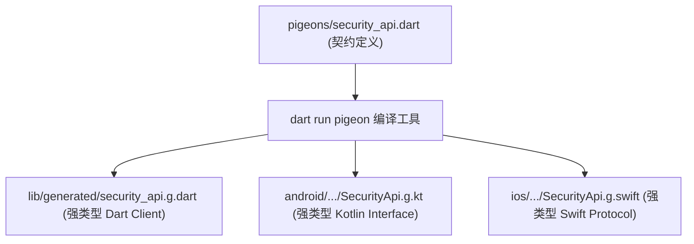
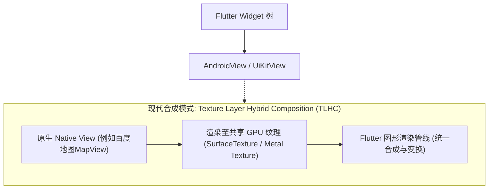

# 08 原生互操作与混合开发实践

尽管 Flutter 的跨端 UI 渲染能力极为出众，但在真实企业级开发中，我们不可避免地需要调用原生硬件能力或集成第三方原生 SDK：
- 银行/政企级专属安全加密芯片（SE / TEE）、人脸识别与活体检测 SDK；
- 蓝牙 BLE 外设通信、NFC 读写、高精车载 GPS 传感器；
- 微信开放平台登录/支付、支付宝 SDK；
- 混合开发（在既有 Native Android / iOS 宿主工程中嵌入 Flutter 模块）。

本篇将深入剖析 Flutter 与原生的底层通信机制，揭秘手动 `MethodChannel` 的类型安全缺陷，并落地 Google 官方推荐的**类型安全跨语言通信利器 —— Pigeon**，最后解析 **Platform View 原生视图嵌入**与 **Add-to-App 混合工程架构**。

---

## 1. 原生通信信道架构解析

Flutter 与宿主平台（Android / iOS / macOS / Windows）运行在不同的语言运行时（Dart VM vs JVM/ART vs Swift/Objective-C Runtime），它们之间通过**二进制消息信道（BinaryMessenger）**进行异步串行化通信：

```mermaid
flowchart LR
    subgraph FlutterRuntime["Flutter (Dart VM)"]
        D1["Dart 业务逻辑"] --> Channel["MethodChannel / EventChannel / Pigeon"]
    end

    subgraph BinaryPipe["二进制底层管道 (StandardMessageCodec)"]
        Channel <===>|字节缓冲 (ByteBuffer)| NativePipe["平台分发器 (BinaryMessenger)"]
    end

    subgraph NativeRuntime["原生宿主 (Android / iOS)"]
        NativePipe --> Android["Kotlin / Java Handler"]
        NativePipe --> iOS["Swift / Objective-C Handler"]
    end
```

### 三大通信信道对比：

| 信道类型 | 传输模式 | 适用业务场景 |
| :--- | :--- | :--- |
| **`MethodChannel`** | 异步 RPC 请求-响应（Request-Response） | 单次触发执行的原生动作：获取设备唯一识别码（IMEI/IDFA）、调用支付、震动反馈 |
| **`EventChannel`** | 原生向 Dart 单向持续事件流（Stream） | 持续产生数据的传感器：陀螺仪、电池电量监听、网络连接变化、蓝牙数据帧流 |
| **`BasicMessageChannel`** | 连续收发的双向半结构化/二进制数据 | 大数据块传输、原生相机连续预览图像帧传输 |

---

## 2. 传统 MethodChannel 的痛点与 Pigeon 破局

### 2.1 传统手写通信的隐患

在传统的 `MethodChannel` 中：
- 方法名（如 `'getBatteryLevel'`）依赖硬编码字符串，拼错一个字母在编译期毫无感知；
- 入参和返回值必须手动进行 `Map<String, dynamic>` 弱类型拆包强转，极易触发 `TypeError` 崩溃；
- 跨端协作成本高，Flutter 与原生 iOS、Android 团队必须反复人工对齐字段契约。

### 2.2 Pigeon：类型安全代码生成框架

Google 官方推出的 **Pigeon** 彻底解决了跨语言契约问题。它的机制是：**在单独的 Dart 文件中定义纯接口与数据传输模型（Schema），通过构建工具自动编译生成双端（Dart + Kotlin/Java + Swift/ObjC）的高性能强类型桥接代码**！



---

## 3. 生产级 Pigeon 跨端通信实战（硬件级设备安全检测）

假设我们需要封装一个企业级原生能力：**检测当前移动设备是否被 Root / 越狱，并读取硬件芯片级安全证书指纹**。

### 3.1 引入依赖

```yaml
# pubspec.yaml
dev_dependencies:
  pigeon: ^22.4.0
```

### 3.2 定义类型安全通信契约 (Schema)

在根目录下创建 `pigeons/security_service.dart`：

```dart
// pigeons/security_service.dart
import 'package:pigeon/pigeon.dart';

// 配置生成代码的输出路径与包名
@ConfigurePigeon(PigeonOptions(
  dartOut: 'lib/core/native/generated/security_api.g.dart',
  dartOptions: DartOptions(),
  kotlinOut: 'android/app/src/main/kotlin/com/enterprise/app/SecurityApi.g.kt',
  kotlinOptions: KotlinOptions(package: 'com.enterprise.app'),
  swiftOut: 'ios/Runner/SecurityApi.g.swift',
  swiftOptions: SwiftOptions(),
))

// 1. 定义跨语言传输数据结构
class DeviceSecurityReport {
  final bool isJailbrokenOrRooted;
  final String hardwareFingerprint;
  final int securityPatchLevel;

  DeviceSecurityReport({
    required this.isJailbrokenOrRooted,
    required this.hardwareFingerprint,
    required this.securityPatchLevel,
  });
}

// 2. 定义 Dart 调用原生的 API 接口 (HostApi)
@HostApi()
abstract class DeviceSecurityHostApi {
  @async
  DeviceSecurityReport checkSecurityStatus();

  void triggerSecurityWipe(String reason);
}

// 3. 定义原生主动向 Flutter 推送事件的 API (FlutterApi)
@FlutterApi()
abstract class SecurityAlertFlutterApi {
  void onSecurityTamperDetected(String alertMessage);
}
```

### 3.3 执行 Pigeon 代码生成命令

```bash
dart run pigeon --input pigeons/security_service.dart
```

执行后，Pigeon 会自动在 Dart、Android Kotlin 与 iOS Swift 目录下生成对应的接口与序列化桥接层。

### 3.4 Android 原生端实现 (Kotlin)

在 Android 工程的 `MainActivity.kt` 中实现生成的 `DeviceSecurityHostApi` 接口：

```kotlin
// android/app/src/main/kotlin/com/enterprise/app/MainActivity.kt
package com.enterprise.app

import io.flutter.embedding.android.FlutterActivity
import io.flutter.embedding.engine.FlutterEngine
import android.os.Build
import java.io.File

class MainActivity: FlutterActivity() {
    override fun configureFlutterEngine(flutterEngine: FlutterEngine) {
        super.configureFlutterEngine(flutterEngine)

        // 注册 Pigeon 生成的 HostApi 绑定实现
        DeviceSecurityHostApi.setUp(flutterEngine.dartExecutor.binaryMessenger, SecurityApiImpl())
    }
}

class SecurityApiImpl : DeviceSecurityHostApi {
    override fun checkSecurityStatus(callback: (Result<DeviceSecurityReport>) -> Unit) {
        // 原生底层 Root 检查：检查 su 二进制文件与常见提权路径
        val isRooted = checkRootMethod()
        val report = DeviceSecurityReport(
            isJailbrokenOrRooted = isRooted,
            hardwareFingerprint = Build.FINGERPRINT ?: "UNKNOWN_FINGERPRINT",
            securityPatchLevel = Build.VERSION.SDK_INT.toLong()
        )
        // 异步安全返回强类型报告
        callback(Result.success(report))
    }

    override fun triggerSecurityWipe(reason: String) {
        // 执行就地数据抹除操作
        println("Security wipe initiated due to: $reason")
    }

    private fun checkRootMethod(): Boolean {
        val paths = arrayOf(
            "/system/app/Superuser.apk",
            "/sbin/su",
            "/system/bin/su",
            "/system/xbin/su",
            "/data/local/xbin/su"
        )
        for (path in paths) {
            if (File(path).exists()) return true
        }
        return false
    }
}
```

### 3.5 iOS 原生端实现 (Swift)

在 iOS 工程的 `AppDelegate.swift` 中实现生成的 `DeviceSecurityHostApi` 协议：

```swift
// ios/Runner/AppDelegate.swift
import Flutter
import UIKit

@main
@objc class AppDelegate: FlutterAppDelegate {
  override func application(
    _ application: UIApplication,
    didFinishLaunchingWithOptions launchOptions: [UIApplication.LaunchOptionsKey: Any]?
  ) -> Bool {
    let controller : FlutterViewController = window?.rootViewController as! FlutterViewController
    
    // 注册 Pigeon 协议绑定
    let securityApi = SecurityApiImpl()
    DeviceSecurityHostApiSetup.setUp(binaryMessenger: controller.binaryMessenger, api: securityApi)

    GeneratedPluginRegistrant.register(with: self)
    return super.application(application, didFinishLaunchingWithOptions: launchOptions)
  }
}

class SecurityApiImpl: DeviceSecurityHostApi {
  func checkSecurityStatus(completion: @escaping (Result<DeviceSecurityReport, Error>) -> Void) {
    // 检查越狱常见路径与 Cydia 标识
    let isJailbroken = FileManager.default.fileExists(atPath: "/Applications/Cydia.app") ||
                       FileManager.default.fileExists(atPath: "/Library/MobileSubstrate/MobileSubstrate.dylib")
    
    let report = DeviceSecurityReport(
      isJailbrokenOrRooted: isJailbroken,
      hardwareFingerprint: UIDevice.current.identifierForVendor?.uuidString ?? "UNKNOWN_UUID",
      securityPatchLevel: 17 // 对应 iOS 规范版本
    )
    completion(.success(report))
  }

  func triggerSecurityWipe(reason: String) {
    print("iOS Wipe triggered: \(reason)")
  }
}
```

### 3.6 Flutter 业务层调用（纯强类型）

```dart
// lib/features/security/data/device_security_client.dart
import '../../core/native/generated/security_api.g.dart';

class DeviceSecurityClient {
  final DeviceSecurityHostApi _api = DeviceSecurityHostApi();

  Future<DeviceSecurityReport> inspectDevice() async {
    try {
      // 没有任何字符串方法名，全流程编译期强类型提示！
      final report = await _api.checkSecurityStatus();
      if (report.isJailbrokenOrRooted) {
        print('严重警告：当前运行环境处于越狱/Root 状态，指纹: ${report.hardwareFingerprint}');
      }
      return report;
    } catch (e) {
      print('原生安全检查通信异常: $e');
      rethrow;
    }
  }
}
```

---

## 4. Platform View：嵌入原生视图

在某些业务场景下（如高德/谷歌地图、原生视频播放器、或者承载旧 Web 页面使用的 WKWebView），我们必须将真实的 Android `View` 或 iOS `UIView` 嵌入到 Flutter 的 Widget 树中。



### 4.1 核心注意事项与性能成本

> [!CAUTION]
> **Platform View 的性能红线**：
> 1. **合成性能开销**：嵌入原生视图需要跨图形管线进行纹理拷贝与事件同步，成本远高于 Flutter 纯自绘 Widget。**严禁在 `ListView` 列表项中频繁嵌套 Platform View**！
> 2. **手势冲突治理**：Flutter 与原生视图的手势竞争需要配置 `gestureRecognizers` 显式声明手势穿透优先级。
> 3. **模式选择**：Android 现代版本默认推荐使用 **Texture Layer Hybrid Composition (TLHC)**，在兼顾输入法弹起的同时享有最高的帧率表现。

---

## 5. Add-to-App 混合工程架构

若公司已有成熟的大型 Native 原生应用，往往无法全量重写，而是采用“**既有 Native App + 局部关键业务使用 Flutter 模块**”的混合模式。

### 5.1 FlutterEngineGroup 引擎复用池

在传统混合开发中，每次打开一个 Flutter 页面都会启动一个全新的 `FlutterEngine`，产生高达 30MB~50MB 的独立内存开销。
Google 官方推出的 **`FlutterEngineGroup`** 支持多个 Flutter 页面共享同一套底层的 JIT/AOT 代码、GPU 上下文与字体资源，每个后续新增的引擎实例仅额外消耗 **180KB** 的轻量内存！

```kotlin
// Android 原生宿主中声明全局引擎池
class MyApplication : Application() {
    lateinit var engineGroup: FlutterEngineGroup

    override fun onCreate() {
        super.onCreate()
        engineGroup = FlutterEngineGroup(this)
    }
}

// 快速启动秒开 Flutter Activity
val options = FlutterActivityLaunchConfigs.BackgroundMode.opaque
val intent = FlutterActivity.CachedEngineIntentBuilder(CustomFlutterActivity::class.java, "engine_id")
    .build(context)
```

---

## 6. 架构总结

1. **废弃手写 Channel**：企业级双端通信全面采用 **Pigeon** 驱动，依靠编译器保障协议严谨性，消灭运行期拆包崩溃。
2. **硬件/第三方 SDK 隔离**：原生交互层对外必须封装为标准的 Domain Repository 抽象接口，让上层业务完全无感原生实现细节。
3. **审慎使用 Platform View**：优先选用纯 Dart 绘制方案；必须引入原生地图/视频时，隔离在其独立页面中，规避复杂的嵌套滚动卡顿。

---

## 7. 官方权威参考资料 (docs.flutter.cn)

- [Platform Channels 平台通道核心机制](https://docs.flutter.cn/platform-integration/platform-channels)
- [Pigeon 强类型代码生成框架官方文档](https://pub.dev/packages/pigeon)
- [C/C++ 原生代码绑定与 Dart FFI](https://docs.flutter.cn/platform-integration/c-interop)
- [Add-to-App 混合工程集成指南](https://docs.flutter.cn/add-to-app)

