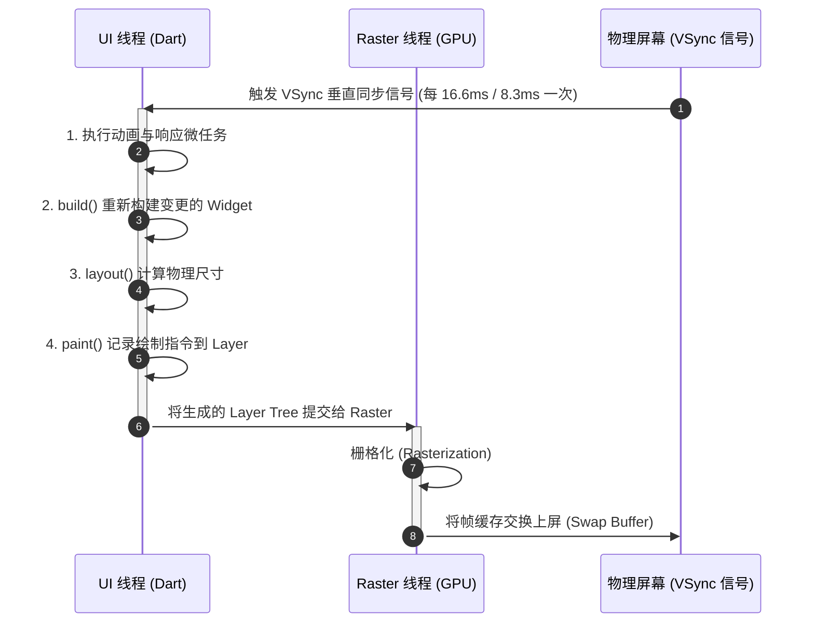
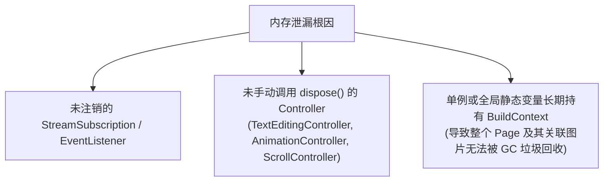
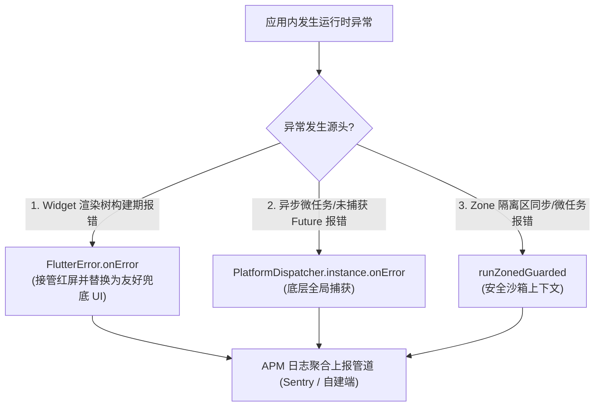

# 09 性能调优、内存治理与 APM 监控体系

在企业级交付中，“能跑通逻辑”与“具备工业级鲁棒性”存在着巨大的鸿沟。一款优秀的跨端企业级应用必须做到：
1. **极致流畅**：在 60Hz 甚至 120Hz 高刷屏上保持平稳运行，无卡顿（Zero Jank）；
2. **零内存泄漏**：长时间运行与页面反复进出，内存平稳不发生阶梯式上涨（OOM）；
3. **全局异常防护**：全方位兜底未捕获异常，建立健全的 **APM（应用性能监控）** 与用户行为追踪日志链路。

本篇将深入剖析 **Flutter 渲染管线双线程模型**、**DevTools 内存泄漏排查**、**渲染卡顿治理黑魔法**，并搭建一套企业级**全局三层异常监控捕获网**。

---

## 1. 性能指标基线与双线程渲染模型

在 Flutter 中，一帧画面的渲染主要由两个核心线程协同完成：
- **UI 线程 (Dart Thread)**：执行 Dart 业务逻辑、构建 Widget 树、执行 RenderObject 布局与绘制指令记录。
- **Raster 线程 (GPU 渲染线程)**：接收 UI 线程生成的绘制图层指令，调用底层 Impeller / Skia 将矢量数据栅格化并提交 GPU 显存。



### 卡顿（Jank）的分类与诊断依据：

| 现象类型 | 触发线程 | 根因剖析 | 治理策略 |
| :--- | :--- | :--- | :--- |
| **UI 线程超时** | UI Thread | 单帧内 Dart 计算过载：大量在主线程解析超大 JSON、复杂正则匹配、Widget 树层级过深且全量重构 | 将繁重计算移至 `Isolate.run()`；局部拆分 Widget，使用 `const` 阻断更新传递 |
| **Raster 线程超时** | Raster Thread | GPU 栅格化开销过重：滥用 `saveLayer`（半透明离屏渲染）、深层嵌套裁剪（`Clip`）、超大图未裁剪直接渲染 | 移除全局 `Opacity`，改用颜色的 Alpha 通道；指定图片 `cacheWidth`/`cacheHeight`；加装 `RepaintBoundary` |

---

## 2. Flutter DevTools 深度剖析实战

Flutter 官方提供了功能强大的网页版诊断套件 **DevTools**。

```bash
# 启动分析模式 (Profile Mode - 最接近生产环境物理性能，杜绝 Debug 模式的 JIT 性能失真)
flutter run --profile
```

### 2.1 性能工具（Performance Profiler）核心排查项

- **Track Widget Rebuilds（追踪组件重建）**：
  开启后，DevTools 会实时统计每个 Widget 在某一帧内的重建次数。若一个仅仅改变局部点赞数字的动作，导致整个列表甚至父级 Scaffold 重绘了 50 次，说明状态作用域过大，需细化 `ref.watch()` 或 `BlocSelector`。
- **Timeline Events & CPU Flame Chart（火焰图）**：
  点击时间轴上的红色超时柱状图，展开火焰图，寻找宽度最长、耗时最久的 Dart 函数。

### 2.2 内存泄漏排查（Memory Inspector）



#### DevTools 内存实战排查三步法：
1. **基准打点**：打开目标页面前，在 DevTools Memory 页面点击 **Take Snapshot**（记录当前堆内存快照）；
2. **高频触发**：反复进入该页面 10 次，然后连续返回上一页；点击垃圾桶图标强制触发 GC（Collect Garbage）；
3. **差量比对**：再次点击 Take Snapshot。比对两次快照中的对象实例计数。若目标 Page 的 `State` 数量显示为 10，则**绝对存在内存泄漏**！展开 Retaining Path（引用持有路径），即可直接定位是哪个静态集合或单例强引用了它。

---

## 3. 生产级性能调优四大铁律

### 3.1 铁律一：将局部刷新范围收窄至极致

```dart
// ❌ 错误示范：在整个页面顶层 watch 全局状态，一处动全屏重绘
class BadCartPage extends ConsumerWidget {
  const BadCartPage({super.key});

  @override
  Widget build(BuildContext context, WidgetRef ref) {
    // 监听购物车总金额
    final totalAmount = ref.watch(cartTotalAmountProvider);

    return Scaffold(
      appBar: AppBar(title: const Text('购物车')),
      body: Column(
        children: [
          const ExpensiveComplexBanner(), // 无辜受累重绘！
          Text('总价: $totalAmount'),
        ],
      ),
    );
  }
}

// ✅ 正确示范：使用独立的局部 Consumer 包裹变动区域
class GoodCartPage extends StatelessWidget {
  const GoodCartPage({super.key});

  @override
  Widget build(BuildContext context) {
    return Scaffold(
      appBar: AppBar(title: const Text('购物车')),
      body: Column(
        children: [
          const ExpensiveComplexBanner(), // 完全免疫，零重绘
          Consumer(
            builder: (context, ref, child) {
              final totalAmount = ref.watch(cartTotalAmountProvider);
              return Text('总价: $totalAmount');
            },
          ),
        ],
      ),
    );
  }
}
```

### 3.2 铁律二：避免滥用 Opacity 引发离屏渲染（saveLayer）

> [!WARNING]
> 直接使用 `Opacity(opacity: 0.5, child: ...)` 会强制引擎开辟一块离屏显存（Offscreen Buffer），将子树渲染至显存后再执行 Alpha 混合，属于极度昂贵的 GPU 操作。
> - 如果只是调节容器或文字颜色：请直接使用 `color: Colors.black.withOpacity(0.5)`；
> - 如果需要做渐隐动画：请使用 `AnimatedOpacity`。

### 3.3 铁律三：大图内存裁剪与重采样

在移动端中，将一张 4000x3000 分辨率的原生照片直接放入 100x100 像素的圆形头像框中，若不加限制，它将按照全量像素解码进 GPU 显存，一张即可吞噬 **40MB+ 物理显存**！

```dart
// 正确做法：使用 ResizeImage 或 Image.network 的 cacheWidth 显式指定解码尺寸
Image.network(
  avatarUrl,
  // 按照屏幕物理像素密度（dpr）换算后的实际需求尺寸进行解码
  cacheWidth: (100 * MediaQuery.devicePixelRatioOf(context)).round(),
  cacheHeight: (100 * MediaQuery.devicePixelRatioOf(context)).round(),
  fit: BoxFit.cover,
);
```

---

## 4. 企业级全局三层异常监控网（APM 架构）

在移动端生产环境中，严防应用出现闪退或“灰屏/红屏（Red Screen of Death）”。我们必须建立一套无死角的三层防御监控网：



### 生产级统一异常守护器（完整源码）：

```dart
// lib/core/monitoring/app_crash_guard.dart
import 'dart:async';
import 'package:flutter/foundation.dart';
import 'package:flutter/material.dart';

class AppCrashGuard {
  static void runGuardedApp(Widget Function() appBuilder) {
    // 1. 设置第一层：Flutter 框架层级异常接管（替换生产环境红屏）
    FlutterError.onError = (FlutterErrorDetails details) {
      // 在开发期输出到控制台
      FlutterError.presentError(details);
      // 上报至 APM
      _reportErrorToApm(details.exception, details.stack ?? StackTrace.current, context: 'FlutterError.onError');
    };

    // 2. 自定义生产环境崩溃占位视图 (替换致命灰屏)
    ErrorWidget.builder = (FlutterErrorDetails details) {
      return Material(
        child: Container(
          color: Colors.white,
          padding: const EdgeInsets.all(24),
          alignment: Alignment.center,
          child: Column(
            mainAxisSize: MainAxisSize.min,
            children: [
              const Icon(Icons.error_outline, color: Colors.orange, size: 54),
              const SizedBox(height: 16),
              const Text('抱歉，页面出现异常', style: TextStyle(fontSize: 18, fontWeight: FontWeight.bold)),
              const SizedBox(height: 8),
              const Text('技术团队已收到自动告警，请尝试重新打开', style: TextStyle(color: Colors.grey)),
            ],
          ),
        ),
      );
    };

    // 3. 设置第二层：PlatformDispatcher 捕获跨平台引擎与未处理异步错误
    PlatformDispatcher.instance.onError = (error, stack) {
      _reportErrorToApm(error, stack, context: 'PlatformDispatcher.onError');
      return true; // 返回 true 表示异常已被消费处理，阻止 App 闪退
    };

    // 4. 设置第三层：runZonedGuarded 捕获沙箱内所有未处理的 Zone 异常
    runZonedGuarded<Future<void>>(
      () async {
        WidgetsFlutterBinding.ensureInitialized();
        runApp(appBuilder());
      },
      (error, stack) {
        _reportErrorToApm(error, stack, context: 'runZonedGuarded');
      },
    );
  }

  static void _reportErrorToApm(Object error, StackTrace stack, {required String context}) {
    // 此处可接入 Sentry, Bugly, Firebase Crashlytics 或自建日志管道
    if (kReleaseMode) {
      print('[APM-RELEASE-ALERT][$context] Error: $error\nStack: $stack');
    } else {
      print('[APM-DEBUG][$context] Error: $error');
    }
  }
}
```

在入口中一键挂载：
```dart
// main.dart
void main() {
  AppCrashGuard.runGuardedApp(() => const MyAppRoot());
}
```

---

## 5. 架构总结

1. **两线程心智**：卡顿时先排查是 UI 线程（Dart 计算过重）还是 Raster 线程（GPU 渲染复杂层级过重）。
2. **常量先行**：尽可能为无状态组件挂载 `const`，使编译期能够固化虚拟 DOM 树，减少无谓的 `build()` 穿透。
3. **显存敏感**：网络图片必须附带 `cacheWidth` / `cacheHeight` 约束，严防单图爆内存引发 OOM。
4. **防御体系**：通过 `AppCrashGuard` 实现三层异常截流，杜绝任何未经兜底的致命闪退。

---

## 6. 官方权威参考资料 (docs.flutter.cn)

- [Flutter 性能优化全景指南](https://docs.flutter.cn/perf)
- [DevTools 性能剖析与火焰图分析](https://docs.flutter.cn/tools/devtools/performance)
- [DevTools 内存泄露与快照排查](https://docs.flutter.cn/tools/devtools/memory)
- [Flutter 异常处理与崩溃治理](https://docs.flutter.cn/testing/errors)

