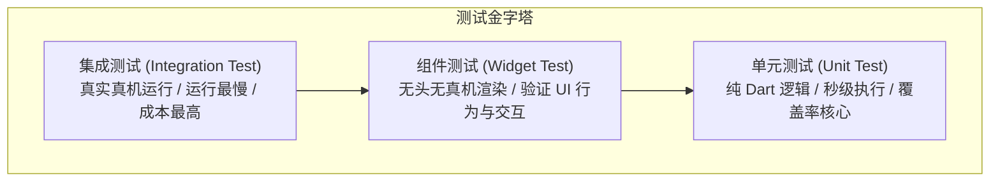

# 10 测试策略、CI/CD 与自动化构建

在大型企业级跨端工程中，代码质量与持续交付（CI/CD）体系是保障多人协同敏捷迭代的护城河。没有健全的自动化测试与流水线，随着业务代码膨胀，任何一次小改动都可能引发致命的生产回归。

本篇将深入剖析 **Flutter 测试金字塔（单元测试 / Widget 测试 / 集成测试）**、基于 **`mocktail`** 的全套 Mock 实战，并提供开箱即用的 **企业级静态代码扫描规范（Linter）** 与 **GitHub Actions 跨端多平台自动化构建流水线配置**。

---

## 1. Flutter 测试金字塔体系



| 测试类型 | 测试对象 | 运行环境 | 执行耗时 | 企业推荐覆盖率指标 |
| :--- | :--- | :--- | :--- | :--- |
| **Unit Test（单元测试）** | Domain 层 UseCase、Entity、工具函数、纯计算算法 | 本地 Dart VM（无图形引擎） | 毫秒级 | 核心业务与领域层 **> 85%** |
| **Widget Test（组件测试）** | 通用组件库、表单、特定复杂页面视图行为 | 内存模拟无头渲染环境（Headless） | 秒级 | 核心通用组件 **> 70%** |
| **Integration Test（集成测试）** | 登录闭环、支付主链路、端到端真实操作 | Android / iOS 真实真机或模拟器 | 分钟级 | 覆盖 3~5 条核心主干业务链路 |

---

## 2. 单元测试与 Mock 实操（基于 mocktail）

在现代 Flutter 中，推荐使用 **`mocktail`** 替代老旧的 `mockito`。`mocktail` 完美契合 Dart 健全空安全，且**无需运行繁重的 `build_runner` 生成代码**。

### 2.1 依赖安装

```yaml
# pubspec.yaml
dev_dependencies:
  flutter_test:
    sdk: flutter
  mocktail: ^1.0.4
```

### 2.2 编写企业级业务 UseCase 单元测试

测试场景：验证 `LoginUseCase` 在密码过短时直接抛出业务异常，在网络正常时成功返回 `UserEntity`：

```dart
// test/features/auth/domain/usecases/login_usecase_test.dart
import 'package:flutter_test/flutter_test.dart';
import 'package:mocktail/mocktail.dart';
import 'package:your_app/features/auth/domain/entities/user_entity.dart';
import 'package:your_app/features/auth/domain/repositories/auth_repository.dart';
import 'package:your_app/features/auth/domain/usecases/login_usecase.dart';

// 声明 Mock 类
class MockAuthRepository extends Mock implements AuthRepository {}

void main() {
  late LoginUseCase useCase;
  late MockAuthRepository mockRepository;

  // 每个用例执行前重置测试上下文
  setUp(() {
    mockRepository = MockAuthRepository();
    useCase = LoginUseCase(mockRepository);
  });

  const tAccount = 'developer@enterprise.com';
  const tPassword = 'secure_password_123';
  const tUser = UserEntity(
    id: 'U1001',
    email: tAccount,
    nickname: 'Flutter Architect',
    isVip: true,
  );

  group('LoginUseCase 业务契约测试', () {
    test('当前置校验账号为空时，应当拦截请求并抛出 ArgumentError，绝不调用底层的 Repository', () async {
      // 验证直接抛出异常
      expect(
        () => useCase(account: '', password: tPassword),
        throwsA(isA<ArgumentError>()),
      );

      // 断言底层的 Repository 方法零次被调用
      verifyZeroInteractions(mockRepository);
    });

    test('当前置校验密码短于6位时，抛出明确错误', () async {
      expect(
        () => useCase(account: tAccount, password: '123'),
        throwsA(isA<ArgumentError>()),
      );
      verifyZeroInteractions(mockRepository);
    });

    test('当账号密码合法且底层成功时，正确返回 UserEntity', () async {
      // 1. Arrange: 录制 Mock 行为
      when(() => mockRepository.loginWithPassword(account: tAccount, password: tPassword))
          .thenAnswer((_) async => tUser);

      // 2. Act: 执行目标业务
      final result = await useCase(account: tAccount, password: tPassword);

      // 3. Assert: 严密断言
      expect(result, equals(tUser));
      expect(result.isVip, isTrue);

      // 验证该方法被精确调用了 1 次
      verify(() => mockRepository.loginWithPassword(account: tAccount, password: tPassword)).called(1);
    });
  });
}
```

执行命令：
```bash
flutter test test/features/auth/domain/usecases/login_usecase_test.dart
```

---

## 3. Widget 组件测试实战（模拟 UI 交互）

测试场景：测试我们前面封装的 `EnterpriseTextField`，验证在输入不合法邮箱时，点击提交能够正确呈现错误文案。

```dart
// test/core/widgets/enterprise_text_field_test.dart
import 'package:flutter/material.dart';
import 'package:flutter_test/flutter_test.dart';
import 'package:your_app/core/forms/form_validators.dart';
import 'package:your_app/core/widgets/enterprise_text_field.dart';

void main() {
  testWidgets('EnterpriseTextField 应当在输入非法邮箱时触发校验提示', (WidgetTester tester) async {
    final controller = TextEditingController();
    final formKey = GlobalKey<FormState>();

    // 1. pumpWidget 将组件注入内存中的虚拟测试树
    await tester.pumpWidget(
      MaterialApp(
        home: Scaffold(
          body: Form(
            key: formKey,
            child: EnterpriseTextField(
              label: '邮箱',
              controller: controller,
              validators: [
                Validators.required('邮箱必填'),
                Validators.email('邮箱格式错误'),
              ],
            ),
          ),
        ),
      ),
    );

    // 2. 初始状态：确保界面能渲染出 Label
    expect(find.text('邮箱'), findsOneWidget);
    expect(find.text('邮箱格式错误'), findsNothing);

    // 3. 模拟用户键盘输入错误格式的文本
    await tester.enterText(find.byType(TextFormField), 'invalid_email_string');
    
    // 手动触发表单校验
    formKey.currentState!.validate();

    // 4. pumpAndSettle 等待动画与微任务执行稳定
    await tester.pumpAndSettle();

    // 5. 断言：界面上成功弹出了错误提示语
    expect(find.text('邮箱格式错误'), findsOneWidget);
  });
}
```

---

## 4. 企业级静态代码分析规范 (analysis_options.yaml)

良好的静态代码分析器（Linter）能在编码阶段直接杜绝 80% 的隐蔽低级 Bug。企业级推荐基线如下：

```yaml
# analysis_options.yaml
include: package:flutter_lints/flutter.yaml

analyzer:
  language:
    strict-casts: true      # 禁止隐式向下类型强转 (消除 dynamic 隐患)
    strict-inference: true  # 严格类型推断
    strict-raw-types: true  # 泛型参数必填，禁止裸用 List 或 Map
  errors:
    missing_required_param: error
    missing_return: error
    todo: ignore

linter:
  rules:
    - prefer_const_constructors             # 强制使用 const 构造，提升渲染性能
    - prefer_const_declarations
    - prefer_final_locals                   # 局部变量优先声明为 final
    - avoid_print                           # 严禁在生产代码中使用 print (必须使用 logger)
    - unawaited_futures                     # 异步 Future 必须显式 await 或 unawaited 处理
    - cancel_subscriptions                  # 强制要求注销 Stream 监听，防止内存泄漏
    - close_sinks                           # 强制关闭 Sink
    - use_super_parameters                  # 采用 Dart 3 super 参数语法糖
```

在本地或 CI 执行扫描：
```bash
flutter analyze
```

---

## 5. 企业级 GitHub Actions 自动化 CI/CD 流水线

以下是一份完整的生产级 GitHub Actions 流水线，在向 `main` 分支提交代码或发起 Pull Request 时自动执行：**环境检测、代码静态规范分析、全量单元与组件测试，并自动化构建 Android APK 与 Web WASM 生产产物**。

```yaml
# .github/workflows/flutter_ci_cd.yml
name: Enterprise Flutter CI/CD Pipeline

on:
  push:
    branches: [ "main", "release/*" ]
  pull_request:
    branches: [ "main" ]

jobs:
  quality-gate:
    name: Code Quality & Testing Gate
    runs-on: ubuntu-latest

    steps:
      - name: Checkout Code
        uses: actions/checkout@v4

      - name: Setup Java SDK
        uses: actions/setup-java@v4
        with:
          distribution: 'zulu'
          java-version: '17'

      - name: Setup Flutter Engine
        uses: subosito/flutter-action@v2
        with:
          flutter-version: '3.24.x'
          channel: 'stable'
          cache: true

      - name: Install Dependencies
        run: flutter pub get

      - name: Verify Code Formatting
        run: dart format --output=none --set-exit-if-changed .

      - name: Run Static Code Analysis (Linter)
        run: flutter analyze --fatal-infos

      - name: Run Unit & Widget Tests with Coverage
        run: flutter test --coverage

      - name: Check Coverage Threshold
        uses: VeryGoodOpenSource/very_good_coverage@v3
        with:
          path: coverage/lcov.info
          min_coverage: 75 # 设定严格的单测覆盖率门槛 (不达标流水线自动中断)

  build-artifacts:
    name: Build Multi-Platform Artifacts
    needs: quality-gate
    runs-on: ubuntu-latest
    if: github.event_name == 'push' && github.ref == 'refs/heads/main'

    steps:
      - name: Checkout Code
        uses: actions/checkout@v4

      - name: Setup Flutter Engine
        uses: subosito/flutter-action@v2
        with:
          flutter-version: '3.24.x'
          channel: 'stable'

      - name: Install Dependencies
        run: flutter pub get

      # 1. 构建 Android Release APK
      - name: Build Android Release APK
        run: flutter build apk --release --dart-define-from-file=env/env_prod.json

      # 2. 构建 Web WASM 产物
      - name: Build Flutter Web (WASM enabled)
        run: flutter build web --wasm --release

      # 3. 归档交付包供团队下载
      - name: Upload Android APK
        uses: actions/upload-artifact@v4
        with:
          name: enterprise-release-apk
          path: build/app/outputs/flutter-apk/app-release.apk

      - name: Upload Web Dist
        uses: actions/upload-artifact@v4
        with:
          name: enterprise-web-dist
          path: build/web
```

---

## 6. Fastlane 自动化打包与分发总览

对于 iOS 和 Android 官方应用商店（App Store / Google Play）的自动化提审，推荐在移动端工程中配置 **Fastlane**：

```ruby
# ios/fastlane/Fastfile
default_platform(:ios)

platform :ios do
  desc "自动化推送 TestFlight 内部测试版本"
  lane :beta do
    setup_ci
    match(type: "appstore") # 自动化证书签名同步
    build_app(
      workspace: "Runner.xcworkspace",
      scheme: "Runner",
      export_method: "app-store"
    )
    upload_to_testflight(skip_waiting_for_build_processing: true)
  end
end
```

只需在终端输入 `bundle exec fastlane beta`，即可完成“构建、打签名包、上传 TestFlight、通知企业微信/Slack”全自动流程。

---

## 7. 架构总结

1. **测试不可妥协**：遵循测试金字塔，Domain 纯业务层通过 `mocktail` 实现 100% 独立单测覆盖；UI 层利用 `testWidgets` 锁死交互边界。
2. **规范先于编码**：启用严格模式的 `analysis_options.yaml`，杜绝 `dynamic` 滥用与内存泄漏隐患。
3. **交付全链路自动化**：CI/CD 负责代码准入、覆盖率拦截以及跨平台产物一键构建，将研发精力从繁杂的打包发布事务中彻底释放。

---

## 8. 官方权威参考资料 (docs.flutter.cn)

- [Flutter 测试总览 (Testing Flutter Apps)](https://docs.flutter.cn/testing/overview)
- [Widget 组件测试深入实践](https://docs.flutter.cn/cookbook/testing/widget/introduction)
- [集成测试端到端规范 (integration_test)](https://docs.flutter.cn/testing/integration-tests)
- [持续集成与部署自动化 (Continuous Delivery)](https://docs.flutter.cn/deployment/cd)

