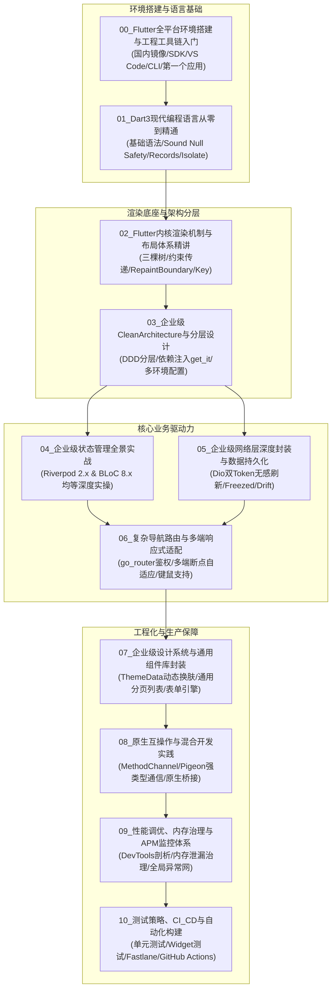

# Flutter 企业级跨端开发架构全景指南

> 本套专栏是一套面向**现代软件工程师**的系统化跨端工程技术指南，基于第一性原理，从底层编译器、图形渲染管线、领域驱动设计（DDD）、双核心状态管理到全平台自适应适配，系统性构建能够支撑复杂工业级系统与高并发业务的跨端工程架构能力。

---

## 🗺️ 全局知识图谱与模块导航

本系列文档由 1 个环境起步模块与 10 个核心技术专题构成，采用严格的模块化工程组织，涵盖环境装配、语言核心、渲染原理、分层架构、状态管理、网络与持久化、多端适配、组件体系、原生交互、性能监控与自动化构建交付。



---

## 📑 模块目录与跳转索引

| 序号 | 模块名称 | 核心知识点 | 文件跳转 |
| :---: | :--- | :--- | :---: |
| **00** | **Flutter 全平台环境搭建与工程工具链入门** | 国内镜像加速源、SDK安装与Path配置、Android Studio/JDK/模拟器配置、VS Code扩展、CLI核心命令、首个计数器应用实战 | [查看文档](./00_Flutter全平台环境搭建与工程工具链入门.md) |
| **01** | **Dart 3 现代编程语言从零到精通** | 零基础 Dart 语法、命名参数、健全空安全、Dart 3 模式匹配、Isolate 并发模型 | [查看文档](./01_Dart3现代编程语言从零到精通.md) |
| **02** | **Flutter 内核渲染机制与布局体系精讲** | 三棵树机制、约束传递（BoxConstraints）、RenderObject、重绘边界、Key 机制 | [查看文档](./02_Flutter内核渲染机制与布局体系精讲.md) |
| **03** | **企业级 Clean Architecture 与分层设计** | DDD 领域分层（Presentation/Domain/Data）、`get_it` 依赖注入、Flavor 与 `--dart-define` 多环境 | [查看文档](./03_企业级CleanArchitecture与分层设计.md) |
| **04** | **企业级状态管理全景实战（Riverpod & BLoC）** | **均等深度**：Riverpod 2.x 代码生成/异步状态 vs BLoC 8.x 单向事件流/HydratedBloc | [查看文档](./04_企业级状态管理全景实战.md) |
| **05** | **企业级网络层深度封装与数据持久化** | Dio 工业级封装（双 Token 无感刷新、防重拦截）、Freezed 不可变数据、Drift/Hive 本地持久化 | [查看文档](./05_企业级网络层深度封装与数据持久化.md) |
| **06** | **复杂导航路由与多端响应式适配** | `go_router` 声明式路由与动态鉴权、跨平台响应式断点（Mobile/Tablet/Web/Desktop）、键鼠操作适配 | [查看文档](./06_复杂导航路由与多端响应式适配.md) |
| **07** | **企业级设计系统与通用组件库封装** | `ThemeData` 设计系统、深色模式切换、高性能下拉刷新分页列表、动态表单校验引擎 | [查看文档](./07_企业级设计系统与通用组件库封装.md) |
| **08** | **原生互操作与混合开发实践** | `MethodChannel`/`EventChannel`、Pigeon 类型安全通信协议、Platform View 与混合工程集成 | [查看文档](./08_原生互操作与混合开发实践.md) |
| **09** | **性能调优、内存治理与 APM 监控体系** | DevTools 深度剖析（卡顿、内存泄漏）、全局异常捕获网（`runZonedGuarded`）、APM 指标监控 | [查看文档](./09_性能调优、内存治理与APM监控体系.md) |
| **10** | **测试策略、CI/CD 与自动化构建** | 单元测试、Widget 测试、`mocktail` 测试框架、Fastlane 多平台构建流水线、GitHub Actions | [查看文档](./10_测试策略、CI_CD与自动化构建.md) |

---

## 🔗 官方权威文档体系索引与对齐

本套专栏的技术实现与规范严格与 Google 官方发布的最新中文文档保持同步：
- 📘 **Flutter 官方中文文档**：[https://docs.flutter.cn/](https://docs.flutter.cn/)
  - [Flutter 核心架构设计 (Architecture)](https://docs.flutter.cn/resources/architectural-overview)
  - [深入理解 Flutter 布局约束 (BoxConstraints)](https://docs.flutter.cn/ui/layout/constraints)
  - [Impeller 新一代图形渲染引擎](https://docs.flutter.cn/perf/impeller)
  - [WebAssembly (WASM) 跨端部署指南](https://docs.flutter.cn/platform-integration/web/wasm)
- 📙 **Dart 官方中文文档**：[https://dart.cn/](https://dart.cn/)
  - [Dart 3 模式匹配与解构 (Patterns)](https://dart.cn/language/patterns)
  - [类修饰符与代数数据类型 (Class Modifiers)](https://dart.cn/language/class-modifiers)
  - [扩展类型与零成本抽象 (Extension Types)](https://dart.cn/language/extension-types)
  - [并发模型与 Isolate (Concurrency)](https://dart.cn/language/concurrency)

---

## ⚡ 现代跨端工程与 Flutter 核心体系技术对照

| 现代通用软件工程概念 | Flutter / Dart 技术实现 | 架构本质与物理机制剖析 |
| :--- | :--- | :--- |
| **强类型系统与类型安全** | **Dart 3.x 静态强类型 + 健全空安全** | 编译期与运行时双重保障，AOT 编译级别彻底消除物理空指针（Sound Null Safety）。 |
| **声明式 UI 与虚拟视图** | **Widget / Element / RenderObject 三棵树** | Widget 为轻量级不可变描述；Element 为生命周期挂载节点；RenderObject 负责真实的几何排版、命中测试与硬件绘制（Paint）。 |
| **弹性布局 (Flex Layout)** | **`Flex`, `Row`, `Column`, `Wrap`** | 遵循“约束向下传递，尺寸向内反馈，父节点决定位置”的确定性单遍布局算法。 |
| **二维图层定位** | **`Stack` + `Positioned`** | 基于绝对像素或百分比约束在父级画板内定位多子项。 |
| **响应式状态管理** | **Riverpod 2.x / BLoC 8.x** | 基于 `InheritedWidget` 在 Element 树上建立依赖注册，实现精准作用域驱动的局部高效重绘。 |
| **网络请求管道** | **`Dio` + 拦截器管道** | 基于双向中间件管道模型，支持底层 HttpAdapter 切换、自签证书校验、代理抓包与并发重试重放。 |
| **声明式客户端路由** | **`go_router`** | 基于 URL 与路由状态机的双向同步，原生支持多分支嵌套导航（StatefulShellRoute）、路由守卫拦截与 Deep Linking。 |
| **多线程并发模型** | **`Isolate` 内存隔离独立线程** | 拥有完全独立的堆内存与垃圾回收（GC）空间，无数据竞争与锁开销，通过 Port 端口进行消息通信。 |
| **包依赖管理** | **`pub` 工具链 (`pubspec.yaml`)** | 语义化版本约束、依赖锁定（`pubspec.lock`）以及依赖覆盖（`dependency_overrides`）。 |
| **编译工具链** | **Flutter JIT / AOT + `build_runner`** | 开发期采用 JIT 虚拟机实现亚秒级热重载（Hot Reload）；生产期通过 AOT 直接编译为无解释器的机器二进制码。 |

---

## 🛠️ 企业级开发环境检查清单

在开始学习前，请确保开发环境已满足以下企业级基线配置：

```bash
# 1. 验证 Flutter 环境与 Dart SDK 版本（推荐 Flutter >= 3.24.x, Dart >= 3.5.x）
flutter doctor -v

# 2. 启用多端平台支持（根据业务需求开启）
flutter config --enable-web
flutter config --enable-windows-desktop
flutter config --enable-macos-desktop

# 3. 推荐 IDE 插件配置
# VS Code 扩展:
# - Flutter (Dart-Code.flutter)
# - Dart (Dart-Code.dart-code)
# - Flutter Riverpod Snippets (robert-brunhage.flutter-riverpod-snippets)
# - Bloc (FelixAngelov.bloc)
# - Error Lens (usernamehw.errorlens)
```

> [!TIP]
> 建议按照 `01` 到 `10` 的编排顺序循序渐进阅读。学习时建议保持“边读架构原理，边动手搭建脚手架”的节奏，重点关注代码规范中对于空安全、常量构造（`const`）以及生命周期销毁的细节控制。

